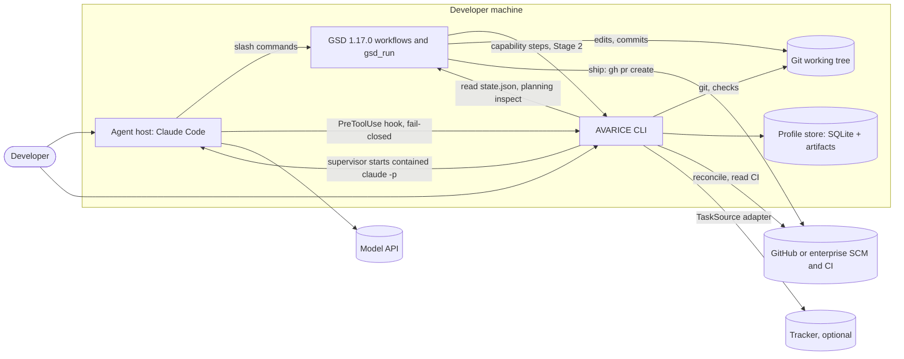
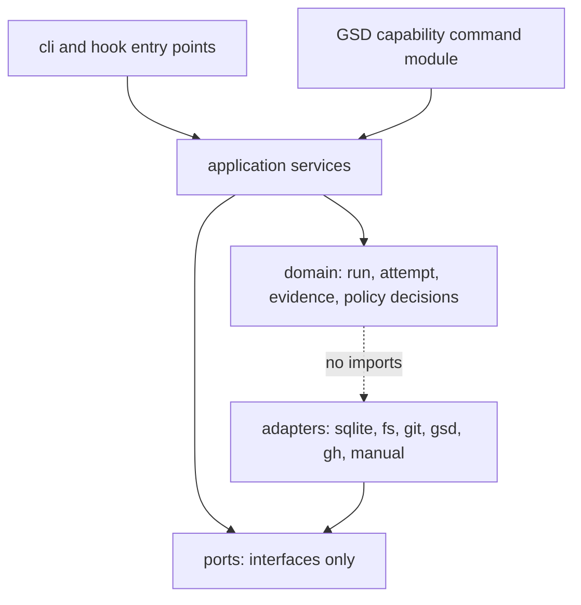
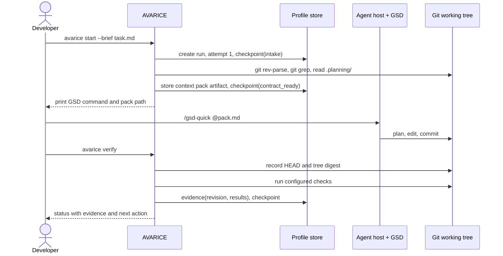

# Architecture

> Status: proposal. Nothing described in this document is built yet; present tense describes the proposed design.

AVARICE (Agent Verification, Automation, Runtime Integration, and Coordination Environment) is a Node CLI. It has eleven in-process modules, a SQLite store per profile, and thin adapters that call git, GSD, `gh`, the agent host and repository check commands as subprocesses. For an unattended run, a supervisor process lives exactly as long as the run is making progress and starts contained headless host invocations, one GSD unit each ([ADR-006](decisions/ADR-006-unattended-delegation.md)). No AVARICE process runs unless a run is active or the user has started a command. GSD keeps planning and execution inside each unit ([ADR-002](decisions/ADR-002-gsd-integration-mode.md)); AVARICE keeps the run envelope around it: the contract, containment, budgets, decisions, gates and evidence. Requirements are owned by [requirements.md](requirements.md) and cited by ID.

This document is normative for module boundaries and dependency direction. Interface signatures live in [contracts-and-state.md](contracts-and-state.md).

## System context

AVARICE never calls a model API. Every model call happens inside the agent host, under the host's own configuration and policy. This keeps NFR-2 (offline orchestration) and the enterprise model-approval question out of AVARICE.

## Process view

| Element | Kind | Lifetime | Present on day one |
|---|---|---|---|
| `avarice` CLI and library | In-process modules | One command | Yes |
| `avarice supervise <run>` | Process started by `avarice start`, `resume` or `decide` | Until the run reaches `ready_for_review`, `waiting_external`, `blocked_on_decision`, `failed`, `cancelled` or `paused` | Yes |
| Contained host invocation (`claude -p` with generated settings, sandbox and hooks) | Subprocess of the supervisor | One GSD unit, bounded by wall-clock and cost caps | Yes |
| `avarice hook <event>` | Subprocess started by the agent host for every tool call | One hook call, timeout 5 s, fail-closed | Yes |
| `avarice digest` | Started by a user-level launchd agent or systemd timer at check-in times | One command | Optional |
| `avarice dashboard --watch` | Foreground command the user starts | Until the user ends it | Optional |
| `git`, `gsd_run`, `gh`, repository check commands | Subprocesses started by the `exec` module | One command, with a timeout | Yes |
| Profile store (`state.db` plus `artifacts/`) | Local files | Persistent | Yes |
| GSD capability `avarice-bridge` | Manifest plus command module inside GSD | Stage 2 | No |
| `avarice mcp` stdio server | Optional subprocess of the host | Only if a host needs typed tools | No |
| Remote worker | Separate service on a NAS or homelab | Later | No |
| Coordination service | Separate service with its own database | Later, only for concurrent workers | No |

There is no permanent daemon. The supervisor exits whenever the run stops needing compute, including while it waits for a human, so a wait costs nothing and survives reboots. Sleep or a kill interrupts at most the current invocation, which the next `resume` reconstructs (NFR-6).

## Modules

All eleven modules live in one package. The boundaries are import rules, enforced by lint (see [dependency direction](#dependency-direction)).

| Module | Owns | Does not own | Called by |
|---|---|---|---|
| `workflow` | The run and work-item state machines, the supervisor loop, invocation outcome classification, transition guards | Planning, execution, retries of steps inside a GSD unit | CLI, supervisor, GSD capability steps |
| `context` | Context pack assembly, budget, citations, freshness checks, index-first retrieval (`gsd-intel`, `gsd-graph`) | The knowledge sources themselves (repo, `.planning/` including intel and graphs) | `workflow`, CLI |
| `ledger` | Persistence of every framework record (runs, attempts, checkpoints, task references, contracts, budgets, work items, decisions, evidence, gate results, approvals, events) and schema migrations; the domain rules for each record belong to the module that produces it | External ticket state, GSD state | All modules through the `Ledger` port |
| `inventory` | Profile resolution, project and workspace identity, path translation, project groups (later) | Checkout creation strategy (GSD and git worktrees own that) | `workflow`, `exec` |
| `exec` | Subprocess execution, timeouts, cancellation, output capture and normalization | Deciding what to run | `verify`, adapters |
| `policy` | Contract compilation and amendment, action classification, rule evaluation, approvals, budget reservation, generation of host settings and sandbox configuration | Executing enforcement (the host, the OS sandbox and external platforms do that), enterprise IAM | `workflow`, hooks |
| `decisions` | Decision records, authority-class matching, response validation, notification batching and the `Notifier` port | Answering consequential questions | `workflow`, CLI |
| `onboarding` | Repository registration, preflight, onboarding lifecycle, staging worktrees, artifact validation, provenance, promotion, project records, active command validation, and the `GsdOnboarding` port | Codebase mapping and planning content (GSD) | CLI, `workflow` |
| `verify` | Running repository checks and test inventories in the sandbox, the `architecture-model` check (FR-25), mechanical mutant generation and the mutation probe, phase gates G0 to G4, evidence bound to revision, environment, contract and policy revision | Goal-level verdicts (GSD verifier) | `workflow`, GSD `verify:post` step |
| `artifacts` | Content-addressed blobs, metadata, quotas, retention | Source code, PR contents | `verify`, `context`, `observe` |
| `observe` | Structured events, redaction, `doctor`, `status` rendering, the static dashboard (FR-26) | Served dashboards, external audit sinks (adapters only) | Every module, CLI |

### Justification per module

| Module | Why it exists | Failure mode | Tested by | Why a simpler alternative is insufficient |
|---|---|---|---|---|
| `workflow` | Resume needs an explicit, persisted state rather than chat memory (FR-2, FR-7) | Illegal transition rejected with the current state shown | State-machine table tests, crash suite | GSD's `HANDOFF.json` covers one GSD session, not intake, evidence and PR feedback across sessions |
| `context` | Plans must be grounded in cited, fresh, bounded context (FR-3, FR-8) | Source unavailable: item marked `unavailable`, pack still produced with the gap listed | Retrieval evaluation, freshness tests | Pasting whole files exceeds budgets and carries no revision or freshness data |
| `ledger` | One durable home for framework-owned records (NFR-6, NFR-9) | Disk full or lock busy: command fails before any side effect | Migration fixtures, kill tests | Plain JSON files give no atomic multi-record update and no concurrency control |
| `inventory` | Profiles and workspace identity must be explicit to keep company data separate (SEC-1) and to translate paths later (NFR-4) | Unknown repository: actionable error asking for registration | Profile isolation suite | Using the current directory as identity breaks with worktrees, renamed folders and remote workers |
| `exec` | Every check and adapter call needs the same timeout, cancellation and redaction behavior (NFR-8) | Timeout or kill: result `timed_out` or `cancelled`, never `passed` | Fake-process tests | Ad hoc `child_process` calls duplicate timeout and capture logic and leak secrets into logs |
| `policy` | Every restriction must come from one compiled contract and reach every enforcement layer (RC-1, CON-1) | Policy source unreadable or contract invalid: no launch; hook denies | Containment suite, precedence tests | Host permission rules alone cannot express budgets, run-scoped approvals or contract versions |
| `decisions` | Humans are involved by decision significance (AUT-1 to AUT-6) | Notifier down: decision stays open in the local inbox | Decision and response validation tests | Letting GSD prompt in a terminal requires someone watching it |
| `onboarding` | Runs need a validated project record, and GSD's mapper writes into whatever checkout it runs in with only prompt-level limits (ONB-1 to ONB-15) | Validation failure: no activation; enforcement failure: `blocked` | Onboarding scenarios S-26 to S-47 | Running `/gsd-onboard` directly in the user's checkout gives no containment, provenance or completeness record |
| `verify` | Completion evidence must name the verified revision (FR-5, FR-6); test strength and boundaries must be measured mechanically (AUT-13, AUT-17, FR-25) | Dirty or changed tree during checks: evidence marked `stale` | Evidence binding tests; mutation probe suite; S-53, S-58, S-59 | A model summary saying "tests pass" is not evidence |
| `artifacts` | Evidence logs and context packs need retention and later relocation (NFR-4, OPS-4) | Quota reached: oldest unreferenced blobs evicted, or the write fails if all are referenced | Artifact contract tests | Storing blobs in SQLite blocks moving bytes to a NAS separately from metadata |
| `observe` | Diagnostics must work without a model or a served dashboard (OPS-1, UC-5); one overview page without a server (FR-26) | Event write fails: command continues, `doctor` reports the gap | Redaction suite, `doctor` snapshot tests, S-56, S-57 | Console logs are neither structured nor redacted |

### Kernel for the first useful workflow

The smallest kernel is `workflow` (with the supervisor), `ledger`, `exec`, `verify` (checks, G2 and G4), `observe`, `policy` and `decisions` with the local notifier. In the kernel, `policy` covers contract compilation, generated host settings with the sandbox, the fail-closed hook and budgets. Containment and unattended progression are both in the kernel; neither is a later hardening step. `context` starts with the four MVP adapters (`gsd-intel`, `gsd-graph`, `git-files`, `gsd-planning`; [list](contracts-and-state.md#contextsource)). `inventory` starts with one profile and explicit repository registration. `artifacts` starts with a local directory. [implementation-plan.md](implementation-plan.md) stages the rest.

## Dependency direction

- `domain` imports nothing outside itself. It contains no paths, URLs, SQL, provider names or host APIs (NFR-3).
- `ports` declare interfaces and capability descriptors. They import only `domain` types.
- `adapters` implement ports and are the only code that touches SQLite, the filesystem, subprocesses or the network.
- The composition root in `cli` selects adapters from profile configuration.
- A lint rule (`no-restricted-imports` scoped by directory) fails the build when `domain` or `ports` import an adapter or `node:` modules other than `node:crypto`.

## Data flows

### Integration stages

Two integration stages describe how AVARICE connects to GSD, independent of the implementation slices. **Stage 1** uses only GSD's public read surfaces and configuration keys. In attended runs the user starts the GSD command; in unattended runs the supervisor starts it headless ([ADR-006](decisions/ADR-006-unattended-delegation.md)). Either way, AVARICE's gates run after each GSD unit. **Stage 2** adds the `avarice-bridge` GSD capability so the gates block inside GSD's loop ([extensions.md](extensions.md#5-gsd-capability-avarice-bridge-stage-2)).

### Attended run from brief to evidence

This attended flow remains available. The unattended flow, with the supervisor starting each GSD unit, one blocking decision and independent work continuing, is drawn in [autonomy-and-decisions.md](autonomy-and-decisions.md#end-to-end-sequence). In Stage 2, the GSD capability also replaces the manual hand-offs in the attended flow, at the points listed in the [capability manifest](extensions.md#5-gsd-capability-avarice-bridge-stage-2).

### Trust boundaries

| ID | Boundary | What crosses | Control | Enforcer |
|---|---|---|---|---|
| TB-1 | Model output to tool execution | Tool calls proposed by the agent and its subagents | OS sandbox for Bash and children; host permission rules in `dontAsk` mode; fail-closed AVARICE PreToolUse hook; no credentials in the run | OS sandbox and agent host ([containment.md](containment.md#enforcement-coverage-matrix)) |
| TB-2 | Retrieved content to prompts | Tickets, docs, web pages, tool output | Content is data: never parsed for policy; fenced when inserted into packs | AVARICE `context` and `policy` |
| TB-3 | AVARICE to external services | API calls with credentials | Credential references resolved at use; redaction | AVARICE adapters; the service enforces authorization |
| TB-4 | Profile to profile | Any read or write | Separate data roots; profile pinned per run | AVARICE `inventory` |
| TB-5 | Machine to remote worker (later) | Commands, workspace bundles, results | Mutual TLS or SSH identity, bounded command allowlist | Worker service and AVARICE adapter |
| TB-6 | Repository configuration to policy | `.avarice/` files in a repo | Repo files can only add restrictions under an enterprise profile | AVARICE `policy` |
| TB-7 | Governed run to its own governance | Writes to contract, policy, host settings, hooks, ledger | All live in the data root, outside sandbox `allowWrite` and inside `denyRead`; amendments need a TTY outside the run | OS sandbox, host protected paths, AVARICE |

[enterprise-adaptation.md](enterprise-adaptation.md#enforcement-map) lists each control with its enforcer and bypass limitations (SEC-6).

## Source-of-truth ownership

AVARICE holds references and bounded caches; it never becomes the authority for a record another system owns.

| Record | Authoritative owner | AVARICE keeps | Conflict rule |
|---|---|---|---|
| Specifications and design docs | Their repository or documentation system | Reference with revision and retrieval time; cached excerpt in a context pack | Source wins; cached excerpt marked stale on revision change |
| Tickets and acceptance criteria | Tracker, or the manual brief file | `TaskRef` with provider ID, revision or `updated_at`, retrieval time | Refreshed on resume; a changed ticket moves the run to `blocked_on_decision` (reason `ref_changed`) |
| Codebase map documents | GSD `.planning/codebase/` | Path, digest, `last_mapped_commit`, mode, scope and completeness in the project record | GSD content wins; AVARICE never edits it |
| Structured indexes | GSD `.planning/intel/` and `.planning/graphs/` (graphify output) | Path, digest and build commit in the project record | GSD content wins; a stale index is marked, never patched |
| Project records (operational metadata per repository) | AVARICE ledger | Authoritative | New versions only |
| Plans, phases, in-plan tasks | GSD `.planning/` | `state.json` snapshot digest per checkpoint | GSD wins; AVARICE never writes `.planning/` directly |
| Framework checkpoints, attempts, evidence | AVARICE ledger | Authoritative | Not applicable |
| Source code | Git (local) and the SCM remote | Commit SHAs and tree digests only | Git wins |
| CI results | CI system | Reference plus a summarized copy as evidence | CI wins; a re-run creates new evidence |
| Run contracts, budgets, decision records | AVARICE ledger | Authoritative | Contract changes only by amendment |
| Approvals for privileged actions | Enterprise: the SCM, change system or IAM. Personal: the run contract or an AVARICE approval record | Approval reference with scope and expiry | An external denial or revocation overrides any local record |
| PR state and review comments | SCM | `ExternalRef` with number, URL, head SHA | SCM wins; reconciled on resume |
| Deployment state | Deployment system | Out of scope for MVP | Not applicable |
| Artifacts (logs, packs) | AVARICE artifact store | Authoritative for its own blobs | Not applicable |

Deleted sources, revoked access and stale snapshots are states of a reference, defined in [contracts-and-state.md](contracts-and-state.md#reference-freshness).
