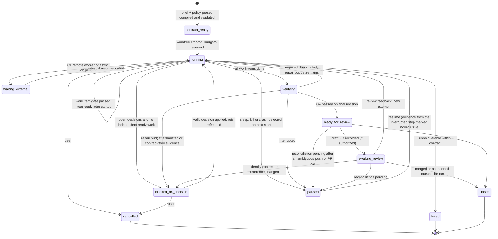

# Contracts and state

This document defines, for AVARICE (Agent Verification, Automation, Runtime Integration, and Coordination Environment), the ports, the error and capability model, the run state machine, the persisted schema and the configuration format. Everything here is a **proposal**: the TypeScript and SQL are interface sketches. The onboarding of one existing repository is built; the store and contracts as built are described in [docs/system/data-model.md](system/data-model.md), and the differences are listed in [docs/system/findings.md](system/findings.md). Requirements are cited by ID from [requirements.md](requirements.md); module ownership comes from [architecture.md](architecture.md#modules).

## Shared conventions

### Results and errors

Every port method returns a `Result`. Adapters never throw across a port boundary, and they never return success for something they did not do (FR-16).

```ts
// Proposal.
type Result<T> = { ok: true; value: T } | { ok: false; error: PortError };

type PortError =
  | { kind: 'unsupported'; capability: string; reducedMode?: string }   // FR-16
  | { kind: 'denied'; rule: string; enforcer: Enforcer }               // policy or remote authz
  | { kind: 'unauthenticated'; credentialRef: string; recovery: string } // expired or missing identity
  | { kind: 'not_found'; ref: string }
  | { kind: 'conflict'; expected: string; actual: string }              // version or precondition mismatch
  | { kind: 'unavailable'; retryAfterMs?: number; cause: string }       // network, rate limit, lock busy
  | { kind: 'timeout'; afterMs: number; sideEffect: 'none' | 'unknown' }
  | { kind: 'cancelled'; sideEffect: 'none' | 'unknown' }
  | { kind: 'invalid'; field: string; reason: string }
  | { kind: 'internal'; cause: string };

type Enforcer = 'host' | 'external-platform' | 'avarice';
```

`sideEffect: 'unknown'` is the trigger for reconciliation (NFR-7). A caller that receives it must run the port's reconciliation lookup (`TaskSource.findByKey` or `ChangeRequests.findByHead`) before any retry.

| Error kind | Retry eligible | Caller action |
|---|---|---|
| `unsupported` | No | Show `reducedMode` or fail the step |
| `denied` | No | Stop; show rule and enforcer |
| `unauthenticated` | After re-authentication by the user | Run moves to `blocked_on_decision` (reason `unauthenticated`) with `recovery` text |
| `not_found` | No | Mark the reference `deleted` |
| `conflict` | After re-reading | Re-read, re-evaluate, ask the user if the decision changes |
| `unavailable` | Yes, with backoff | See [operations-and-testing.md](operations-and-testing.md#operation-budgets) |
| `timeout`, `cancelled` with `sideEffect: 'none'` | Yes | Retry within budget |
| `timeout`, `cancelled` with `sideEffect: 'unknown'` | Only after the reconciliation lookup | Reconcile first |
| `invalid`, `internal` | No | Fail the step, keep evidence |

### Capability descriptors

Each adapter publishes a static descriptor. The composition root checks descriptors against what a workflow step requires, before the step starts.

```ts
// Proposal.
interface CapabilityDescriptor {
  port: string;                 // 'task-source', 'executor', ...
  adapter: string;              // 'manual', 'local', 'github', 'jira:acme'
  version: string;              // adapter semver
  capabilities: Record<string, boolean>;
  attributes?: Record<string, string>;   // non-boolean facts, e.g. { enforcement: 'enforced' | 'restricted' | 'none' }
  extensions?: string[];        // namespaced, e.g. 'github.draftPr' (FR-17)
  offline: boolean;             // usable with no network
}
```

Adapter-specific capability names such as `map-fast` or `headless` appear in their port sections, and the host's enforcement level is the `enforcement` attribute. Boolean capability names used by the core ports: `read`, `write`, `conditionalWrite`, `poll`, `watch`, `remote`, `offline`, `idempotencyKey`, `lookupByKey`, `cancel`, `revisionPinning`. A step that needs `conditionalWrite` from an adapter that lacks it gets `unsupported` with the documented reduced mode (for example, "manual: copy this comment into the ticket").

### Typed references

External records are referenced by their provider identity, unchanged (FR-18).

```ts
// Proposal.
interface ExternalRef {
  provider: string;        // 'github', 'manual', 'jira:acme'  (namespaced instance)
  kind: string;            // 'issue', 'pr', 'doc', 'ci-run', 'brief'
  id: string;              // provider's own ID, verbatim
  url?: string;            // display only; never parsed by domain code
  revision?: string;       // etag, updated_at, commit SHA, or content digest
  retrievedAt: string;     // RFC 3339 UTC
  scope: string;           // what was read: 'title+body', 'file:path#L10-40'
  freshness: Freshness;
}
type Freshness = 'fresh' | 'stale' | 'changed' | 'deleted' | 'access_revoked' | 'unavailable';
```

### Correlation identifiers

| ID | Format | Created by | Carried into |
|---|---|---|---|
| `run_id` | `run_` + ULID | `workflow` at intake | Every event, artifact, approval, branch name suffix |
| `attempt_id` | `att_` + ULID | `workflow` per attempt | Evidence, GSD brief header, commit trailer `Avarice-Attempt:` |
| `invocation_id` | `inv_` + ULID | `exec` per subprocess or adapter call | Events, evidence items |
| `revision` | `git:<sha>` or `tree:<sha256>` for a dirty tree | `verify` | Evidence, checkpoints |
| `ext_ref` | `ExternalRef` | adapters | Checkpoints, events (ID only, no payload) |
| `idempotency_key` | `<run_id>:<action>:<param digest>` | `policy` at approval | External side-effect calls, reconciliation lookups |

ULIDs sort by creation time, which makes event logs readable without a clock-synchronized index. Time comparisons across machines are never used for correctness (see [deployment-and-portability.md](deployment-and-portability.md#concurrent-workers-later)).

## Run contract

Every run executes under a versioned contract (RC-1). AVARICE compiles it from three sources so that a routine task needs no form (RC-2). A **policy preset** supplies reusable limits and authority classes. The **repository conventions** in `.avarice/config.json` supply checks, protected paths and artifact locations. The **brief** supplies behavior, acceptance criteria, exclusions and work items.

This table is the single list of policy presets.

| Preset | Purpose | Mutation gate | Work items added automatically |
|---|---|---|---|
| `routine` | Bug fixes and small features | Optional | None |
| `hardening` | Changes where test strength matters | On | A `harden` item after the last `implement` item |
| `spike` | Exploration in a disposable branch; no delivery | Off | None |
| `docs-only` | Documentation changes; code paths read-only | Off | None |
| `onboarding` | Repository onboarding: source read-only, writes only to the staging `.planning/`, no network, read-only commands ([repository-onboarding.md](repository-onboarding.md#onboarding-contract)) | Off | None |

Every preset also supplies `modelBySize`, the size-to-model map for work items (RC-8). The default is `small` to Haiku, `medium` to Sonnet and `large` to Opus, the same pairing 3dmk's Scrolls documents for `scroll_size` (3dmk documentation, `scrolls.md`). A work item may carry its own `model`, which overrides the map; otherwise the compiler fills it from `size`. The supervisor passes the item's model to the host with `--model`. Each item's `spec.derived` lists the specification fields the compiler derived, and is empty when the brief supplied them all (RC-7). `verification.afterEachItem` takes `required-checks` (default) or `none`, and `none` requires an `afterEachItemReason` (AUT-16). `verification.symbolScope` takes `repair-then-decision` (default from slice 4) or `off` (AUT-17).

`avarice start --brief b.md --policy routine` compiles, validates and stores version 1, prints a one-screen summary, and starts. Running that command is the user's authorization; there is no second confirmation (RC-3).

The contract is stored in the ledger and in the data root, never in the worktree, so the run cannot edit it (CON-6). Its digest is part of every checkpoint and every piece of evidence.

```json
{
  "_note": "Illustrative contract. All limits are example values. The brief itself requested the mutation gate and harden item D; D runs under a derived contract that makes only test paths writable.",
  "schema": 1,
  "contractVersion": 1,
  "runId": "run_01JC8Z3V7Q",
  "policyPreset": "routine",
  "policyRevision": "sha256:4be1...",
  "intent": {
    "behavior": "Expired API tokens are rejected by the auth middleware with a clear error",
    "acceptance": [
      { "id": "AC1", "text": "A request with an expired token is rejected", "verifiedBy": ["check:unit", "test:auth.expired_token_rejected"] },
      { "id": "AC2", "text": "A request with a valid token still succeeds", "verifiedBy": ["check:unit", "test:auth.valid_token_ok"] },
      { "id": "AC3", "text": "No change to token issuance", "verifiedBy": ["diff:src/auth/issue.ts unchanged"] }
    ],
    "exclusions": ["Token refresh flow", "Rate limiting"],
    "requirementRefs": [{ "provider": "manual", "kind": "brief", "id": "briefs/expired-tokens.md", "revision": "sha256:9a0c..." }],
    "workItems": [
      { "id": "A", "task": "Add expiry check in middleware", "size": "medium", "dependsOn": [],
        "spec": { "files": ["src/auth/middleware.ts"], "symbols": ["checkTokenExpiry"], "configKeys": [], "references": ["docs/auth.md#tokens"], "derived": [] } },
      { "id": "B", "task": "Return the error response", "size": "small", "dependsOn": ["A"],
        "spec": { "files": ["src/auth/middleware.ts", "src/auth/errors.ts"], "symbols": ["TokenExpiredError"], "configKeys": [], "references": [], "derived": ["files", "symbols"] } },
      { "id": "C", "task": "Add regression tests for valid tokens", "size": "small", "dependsOn": [],
        "spec": { "files": ["test/auth/middleware.test.ts"], "symbols": [], "configKeys": [], "references": [], "derived": ["files"] } },
      { "id": "D", "type": "harden", "task": "Kill surviving mutants in src/auth/middleware.ts", "size": "large", "dependsOn": ["A", "B", "C"],
        "spec": { "files": ["test/auth/**"], "symbols": [], "configKeys": [], "references": [], "derived": ["files"] } }
    ]
  },
  "workspace": {
    "projectId": "proj_api",
    "baseRevision": "git:4f2c9e1",
    "worktree": "runs/run_01JC8Z3V7Q",
    "branch": "avarice/run_01JC8Z3V7Q"
  },
  "files": {
    "read": ["**"],
    "write": ["src/auth/**", "test/auth/**"],
    "create": ["src/auth/**", "test/auth/**"],
    "delete": [],
    "protected": [".avarice/**", ".github/**", "test/**/fixtures/**", "package.json", "package-lock.json"],
    "artifacts": ["coverage/**", ".cache/**"]
  },
  "execution": {
    "commands": ["npm test", "npm run lint", "npx tsc --noEmit", "git status", "git diff", "git add", "git commit"],
    "tools": ["Read", "Grep", "Glob", "Edit", "Write", "Bash", "Agent"],
    "mcpTools": [],
    "endpoints": ["registry.npmjs.org"],
    "databases": [],
    "environment": "local-sandbox",
    "modelBySize": { "small": "haiku", "medium": "sonnet", "large": "opus" }
  },
  "decisions": {
    "delegated": ["internal naming", "test structure", "refactors inside write paths"],
    "defaults": [{ "class": "error format", "default": "match existing ApiError shape" }],
    "human": ["user-visible status codes", "new dependencies", "public API changes"],
    "prohibited": ["policy changes", "budget changes", "credential changes", "merge"]
  },
  "budgets": {
    "wallClockMinutes": 90, "invocations": 12, "toolCalls": 600, "subagentsConcurrent": 2, "subagentsTotal": 10,
    "costUsd": { "perInvocation": 3.0, "perRun": 20.0, "exactness": "estimated" },
    "retrieval": { "fullReads": 20, "fullReadBytes": 262144, "searches": 60, "broadDiscovery": false },
    "repairAttemptsPerCheck": 3, "artifactMiB": 200
  },
  "verification": {
    "requiredChecks": ["unit", "lint", "types"],
    "gsdVerifier": "required-passed",
    "integrityGates": ["no-new-overrides", "no-test-deletion", "no-skip-markers", "scope-conformance", "prune-is-decision"],
    "afterEachItem": "required-checks",
    "symbolScope": "repair-then-decision",
    "environment": { "os": "darwin", "arch": "arm64" },
    "mutation": {
      "enabled": true, "scope": "changed-lines",
      "operators": ["comparison", "boundary", "boolean", "arithmetic", "constant", "return", "guard-removal"],
      "maxMutants": 60, "perMutantTimeoutSec": 120, "wallClockMinutes": 30,
      "suite": "unit", "survivors": "repair-then-decision", "modelMutants": "supplement"
    }
  },
  "delivery": { "endpoint": "ready_for_review", "pushBranch": true, "draftPr": true, "remote": "origin" },
  "escalation": { "consecutiveDenials": 3, "noProgressInvocations": 2, "contradictoryEvidence": "escalate" },
  "notify": { "reviewReady": ["local", "ntfy:me"], "blocking": ["local", "ntfy:me"], "digest": ["12:30", "17:30"] }
}
```

### Contract amendments

Only the user (personal profiles) or the authorizer named by organization policy (enterprise profiles) can amend a contract, with `avarice contract amend <run>` in an interactive terminal outside the run. The command refuses to run without a TTY and refuses when invoked from inside a run's process tree (it checks the `AVARICE_RUN` marker the supervisor sets and the parent process chain). The agent, subagents and decision answers from a reply channel cannot amend scope, budgets, policy or credentials (RC-5); a reply that asks for one creates an amendment request the user must confirm at a terminal.

Each amendment creates contract version n+1 with the authorizer, reason and a field-level diff (RC-6). Evidence is invalidated by amendment type:

| Amendment changes | Evidence invalidated |
|---|---|
| Acceptance criteria | All gate results and acceptance mappings; checks re-run |
| Writable or protected paths | Scope-conformance results; checks re-run if paths widened |
| Required checks or verification environment | All check evidence |
| Policy revision | Approvals and gate results that cite the old revision |
| Budgets, notifications, exclusions that do not affect acceptance | Nothing |

### Budget accounting

```sql
-- Proposal. Part of schema_version 1; see Persisted entities.
CREATE TABLE budgets (
  run_id TEXT NOT NULL, name TEXT NOT NULL,      -- toolCalls, invocations, costUsd, retrieval.searches, ...
  limit_value REAL NOT NULL, used REAL NOT NULL DEFAULT 0, reserved REAL NOT NULL DEFAULT 0,
  exactness TEXT NOT NULL,                       -- exact | estimated
  contract_version INTEGER NOT NULL,
  PRIMARY KEY (run_id, name)
);
```

A reservation is one statement that succeeds only if it changed one row:

```sql
UPDATE budgets SET reserved = reserved + :n
 WHERE run_id = :r AND name = :b AND used + reserved + :n <= limit_value;
```

Completion moves the amount from `reserved` to `used`; a crashed holder's reservations are released by lease expiry. All subagents and retries reserve from the same rows (CON-13, CON-15). Estimated budgets (model cost) are charged after each invocation from the host's `total_cost_usd`; the per-invocation cap passed as `--max-budget-usd` bounds how far the run total can exceed the plan.

## Ports

This section is the single list of ports. The design proposes twelve: `Workspace`, `CommandExecutor`, `ContextSource`, `TaskSource`, `ChangeRequests`, `ArtifactStore`, `Ledger`, `CredentialProvider`, `EventSink`, `AgentHost`, `Notifier` and `GsdOnboarding`. `AgentHost`, `Notifier` and `GsdOnboarding` have one implementation in the MVP. They are ports because an enterprise or a remote worker must be able to swap the host binding and the notification channel, and because GSD versions change the onboarding surface. Some abstractions are deliberately narrow or merged:

- **Credentials** is a narrow port with one method, because enterprise onboarding needs to swap the provider (Keychain, `gh auth token`, a corporate broker) without touching adapters.
- **Policy** is an in-process module. Only its *sources* (where rules come from) are pluggable, through configuration files. A policy port would invite adapters that bypass rules.
- **Workspace access** merges into `Workspace` (identity plus read access). Writes to the workspace happen through the agent host and GSD.
- **Event reporting** is a port with a local adapter only; an enterprise audit sink is an onboarding adapter.

### Workspace

```ts
// Proposal.
interface Workspace {
  identity(): Promise<Result<WorkspaceIdentity>>;
  revision(): Promise<Result<{ revision: string; clean: boolean; changedPaths: string[] }>>;
  read(path: RelPath, range?: LineRange): Promise<Result<{ text: string; revision: string }>>;
  search(query: string, opts: { maxHits: number; pathGlobs?: string[] }): Promise<Result<SearchHit[]>>;
}
interface WorkspaceIdentity {
  projectId: string;       // stable ID from inventory registration
  repoRemote?: string;     // normalized remote, display only
  rootCommit: string;      // first commit SHA: survives renames and moves
  worktree: RelPath;       // relative to the profile's workspace root
}
```

| Aspect | Contract |
|---|---|
| Identity | `rootCommit` plus `projectId`; never the absolute path |
| Side effects | None (read-only) |
| Timeouts | `read` 2 s, `search` 10 s, `revision` 10 s |
| Cancellation | Abort signal kills the underlying `git` subprocess |
| Consistency | `revision()` reads `HEAD` and computes a digest of tracked plus untracked non-ignored files; a value is valid only for the instant it was computed |
| Local adapter | `git rev-parse`, `git status --porcelain=v2 -z`, `git grep -n -I` |

### CommandExecutor

```ts
// Proposal.
interface CommandExecutor {
  readonly descriptor: CapabilityDescriptor;   // remote, cancel, offline
  run(cmd: CommandSpec, signal: AbortSignal): Promise<Result<CommandResult>>;
}
interface CommandSpec {
  argv: string[];               // no shell string; shell only if the repo's check is declared as one
  cwd: RelPath;                 // relative to workspace root
  env: Record<string, string>;  // explicit allowlist; credentials as refs resolved by the adapter
  timeoutMs: number;
  outputLimitBytes: number;     // default 5 MiB per stream, rest truncated with a marker
  invocationId: string;
}
interface CommandResult {
  exitCode: number | null;
  signal?: string;
  status: 'passed' | 'failed' | 'timed_out' | 'cancelled' | 'spawn_error';
  durationMs: number;
  stdoutArtifact: string;       // artifact digest of the redacted stream
  stderrArtifact: string;
}
```

| Aspect | Contract |
|---|---|
| Side effects | Whatever the command does. `exec` treats every command as possibly mutating the workspace. |
| Timeouts | Required per call; SIGTERM at timeout, SIGKILL 5 s later, process group killed |
| Cancellation | Same as timeout; status `cancelled` |
| Idempotency | None assumed. Verification commands are re-runnable by policy; others are not retried. |
| Containment | The local adapter runs every command inside the OS sandbox configuration generated from the contract; no sandbox means `unavailable`, never an unsandboxed run ([containment.md](containment.md#checks-and-probes-run-sandboxed)) |
| Remote adapter (later) | Same interface; `descriptor.capabilities.remote = true`; workspace passed as a revision with no local path |

### ContextSource

```ts
// Proposal.
interface ContextSource {
  readonly descriptor: CapabilityDescriptor;
  find(query: ContextQuery, budget: TokenBudget): Promise<Result<ContextHandle[]>>;  // no content (FR-22)
  read(handles: ContextHandle[], budget: TokenBudget): Promise<Result<ContextItem[]>>;
  refresh(ref: ExternalRef): Promise<Result<ExternalRef>>;   // returns new freshness and revision
}
interface ContextHandle { ref: ExternalRef; title: string; estTokens: number; reason: string; readRule?: 'descendants' | 'one-hop' | 'id-only'; }
interface ContextItem { ref: ExternalRef; excerpt: string; estTokens: number; reason: string; }
```

Local adapters in the MVP:

| Adapter | Reads | Query | Freshness |
|---|---|---|---|
| `gsd-intel` | `.planning/intel/*.json` (file roles, API map, dependency graph, architecture decisions, stack) | `gsd_run intel query <term>`, JSON entries | `gsd_run intel diff` (file hashes since the last refresh), plus the commit AVARICE recorded at refresh |
| `gsd-graph` | `.planning/graphs/graph.json` | `gsd_run graphify query <term> --budget <n>`: GSD's built-in reader, JSON with a confidence tier per edge; to meet the budget it drops `AMBIGUOUS`, then `INFERRED`, then `EXTRACTED` edges (`bin/lib/graphify.cjs:254-348`) | `built_at_commit` against the active revision |
| `git-files` | Tracked files via `Workspace.search` | Scoped search, then bounded snippets | Revision of the run worktree |
| `gsd-planning` | `PROJECT.md`, `REQUIREMENTS.md`, current phase `CONTEXT.md` and `PLAN.md`, read-only | Whole sections | `state.json` |

The index adapters answer first when the project record lists the index as fresh (FR-20). For a document, `gsd-graph` returns the document node and its referenced nodes, each citing the source path and revision from the corpus manifest; `gsd-planning` section reads become the fallback. A stale index still answers, with every item marked `stale`, and the assembler then confirms each cited path with `git-files`. AVARICE uses GSD's built-in graph reader, never the standalone `graphify query`, because the two return different shapes and interpret `--budget` in different units. Later: `standards` ([extensions.md](extensions.md#12-standards-context-adapter-later)) and enterprise documentation adapters.

Retrieval is handle-first (FR-22). Every adapter's `find` returns handles with token estimates and no content. The assembler deduplicates by `ref`, ranks by reason and confidence, picks handles until the budget is spent, and only then calls `read`. Every pack lists what it left out, with each omitted handle's estimate.

`gsd-graph` maps each graphify edge relation to one read rule: containment loads descendants, dependency loads one hop, and reference returns only the target's ID. graphify does not publish a fixed relation vocabulary, so the mapping is a configuration table that the slice 3 spike fills and validates against real graphs. An unmapped relation defaults to `id-only`. `gsd-planning` also reads GSD's `<phase>-LEARNINGS.md` files, which `/gsd-extract-learnings` writes into each phase directory.

### TaskSource

```ts
// Proposal.
interface TaskSource {
  readonly descriptor: CapabilityDescriptor;
  get(ref: Pick<ExternalRef, 'provider' | 'kind' | 'id'>): Promise<Result<TaskSnapshot>>;
  comment?(ref: ExternalRef, body: string, key: string): Promise<Result<ExternalRef>>; // privileged
  findByKey?(key: string): Promise<Result<ExternalRef | null>>;                       // reconciliation
}
interface TaskSnapshot { ref: ExternalRef; title: string; body: string; acceptance?: string[]; status?: string; }
```

The `manual` adapter reads a Markdown brief file. Its `revision` is the file's SHA-256, so editing the brief marks the reference `changed` on resume. It reports `write: false`, so `comment` returns `unsupported` with reduced mode "print the comment for the user to paste" (FR-19).

### ChangeRequests

PR operations belong to GSD `ship` in the personal profile. AVARICE needs only lookup and reconciliation, plus creation for enterprises where GSD `ship` is not used.

```ts
// Proposal.
interface ChangeRequests {
  readonly descriptor: CapabilityDescriptor;
  findByHead(branch: string): Promise<Result<ExternalRef[]>>;
  status(ref: ExternalRef): Promise<Result<{ state: string; headSha: string; checks: CheckSummary[] }>>;
  create?(req: PrRequest, idempotencyKey: string): Promise<Result<ExternalRef>>; // privileged
}
```

| Aspect | Contract |
|---|---|
| Identity | SCM's PR number and repository, verbatim |
| Timeouts | 15 s per call |
| Idempotency | `create` embeds the key in the PR body footer; `findByHead` plus key match is the reconciliation lookup |
| Ambiguous timeout | `create` returns `timeout` with `sideEffect: 'unknown'`; caller must call `findByHead` before any retry |
| Local adapter | `gh pr list --head`, `gh pr view --json`; uses `gh`'s existing authentication |

### ArtifactStore

```ts
// Proposal.
interface ArtifactStore {
  readonly descriptor: CapabilityDescriptor;
  put(bytes: AsyncIterable<Uint8Array>, meta: ArtifactMeta): Promise<Result<{ digest: string; size: number }>>;
  get(digest: string): Promise<Result<AsyncIterable<Uint8Array>>>;
  has(digest: string): Promise<Result<boolean>>;
  delete(digest: string): Promise<Result<void>>;
}
```

| Aspect | Contract |
|---|---|
| Identity | SHA-256 of content. Metadata (kind, run, retention class) lives in the ledger, not in the store |
| Write atomicity | Write to a temporary file in the same directory, `fsync`, rename. A partial write never appears under its digest |
| Idempotency | `put` of existing content is a no-op returning the same digest |
| Consistency | Read-after-write on the local adapter. A NAS adapter must declare whether it offers the same |
| Disk full | `unavailable` with cause `ENOSPC`; the caller fails the step before recording evidence that references the missing blob |

### Ledger

The ledger is the persistence port for every framework record ([persisted entities](#persisted-entities)). It is intentionally coarse: one transactional method per domain operation, so adapters cannot be used to write half a transition.

```ts
// Proposal.
interface Ledger {
  createRun(input: NewRun): Promise<Result<Run>>;
  transition(runId: string, expectedVersion: number, t: Transition): Promise<Result<Run>>;
  recordEvidence(attemptId: string, e: NewEvidence): Promise<Result<Evidence>>;
  recordApproval(a: NewApproval): Promise<Result<Approval>>;
  storeContract(c: ContractVersion): Promise<Result<void>>;                  // new version; never updates an old one
  reserveBudget(runId: string, name: string, amount: number): Promise<Result<Reservation>>;
  settleBudget(r: Reservation, actual: number): Promise<Result<void>>;
  recordDecision(d: NewDecision): Promise<Result<Decision>>;
  answerDecision(id: string, expectedStateDigest: string, a: Answer): Promise<Result<Decision>>;
  updateWorkItem(runId: string, itemId: string, expectedState: string, next: WorkItemPatch): Promise<Result<void>>;
  recordGate(g: GateResult): Promise<Result<void>>;
  acquireLease(runId: string, holder: string, ttlMs: number): Promise<Result<Lease>>;
  get(runId: string): Promise<Result<RunView>>;
  list(filter: RunFilter): Promise<Result<RunSummary[]>>;
  export(runIds: string[] | 'all'): Promise<Result<AsyncIterable<Uint8Array>>>;
  import(bundle: AsyncIterable<Uint8Array>, mode: 'new-ids' | 'preserve-ids'): Promise<Result<ImportReport>>;
}
```

`transition` checks `expectedVersion` (optimistic concurrency) and the lease fence token, writes the new state, the checkpoint and the event in one SQLite transaction, then returns. A `conflict` result means another process moved the run.

### CredentialProvider

```ts
// Proposal.
interface CredentialProvider {
  resolve(ref: CredentialRef, purpose: string): Promise<Result<SecretHandle>>;
}
type CredentialRef = `keychain:${string}` | `cmd:${string}` | `delegated:${string}`;   // `vault:${string}` added by the slice 6d adapter
```

`delegated:gh` means "the `gh` CLI holds the credential; AVARICE never sees it". That is the default for the personal profile. A `SecretHandle` is used immediately and never serialized. The redactor is seeded with the resolved value for the rest of the process (SEC-2, SEC-3). Every call to `resolve`, successful or not, writes a `credential.resolve` event (SEC-8). The event holds the reference, `purpose`, calling module, run and invocation IDs (the `events` columns), outcome and duration; the profile is implied by the per-profile database. It never holds the value, its length or a digest of it. The port is a broker over existing stores ([ADR-009](decisions/ADR-009-credential-broker.md)).

A later `vault:` adapter (personal-extended profile, slice 6d) resolves `vault:<mount>/<path>#<field>` from Vault or OpenBao's key-value engine. It authenticates with AppRole, and its role ID and secret ID are themselves `keychain:` references. Its policy grants read on `<mount>/avarice/<profile>/*` only, so each profile reads only its own secrets. It writes the same `credential.resolve` event, and an unreachable or sealed server returns `unavailable`, never a cached value.

### EventSink

```ts
// Proposal.
interface EventSink {
  emit(e: Event): void;   // never throws; failures counted and surfaced by doctor
}
interface Event {
  ts: string; level: 'debug' | 'info' | 'warn' | 'error';
  type: string;                 // 'run.transition', 'exec.finished', 'policy.denied', ...
  runId?: string; attemptId?: string; invocationId?: string;
  refs?: Pick<ExternalRef, 'provider' | 'kind' | 'id'>[];
  data: Record<string, unknown>; // redacted before emit returns
}
```

The local adapter appends to the `events` table. An enterprise audit sink adapter forwards a filtered copy and never replaces the local record.

### AgentHost

```ts
// Proposal.
interface AgentHost {
  readonly descriptor: CapabilityDescriptor;   // enforcement: 'enforced' | 'restricted' | 'none'; headless; resume
  invoke(req: InvocationRequest, signal: AbortSignal): Promise<Result<InvocationOutcome>>;
}
interface InvocationRequest {
  runId: string; workItem: string; contractVersion: number;
  prompt: string;                          // e.g. '/gsd-quick --validate --text "<task>"'
  resumeSession?: string;                  // answer to a GSD pause
  settingsFile: string;                    // generated from the contract; outside the worktree
  model: string;                           // from work_items.model (RC-8)
  costCapUsd: number; wallClockMs: number;
}
interface InvocationOutcome {
  sessionId: string;
  kind: 'progressed' | 'paused' | 'denied' | 'budget_exhausted' | 'failed' | 'no_progress' | 'inconclusive';
  question?: string;                       // captured GSD pause text, fenced as data
  permissionDenials: { tool: string; reason: string }[];
  costUsd: number; durationMs: number; headBefore: string; headAfter: string;
  gsdStateDigestBefore: string; gsdStateDigestAfter: string;
  transcriptArtifact: string;              // redacted stream-json
}
```

| Aspect | Contract |
|---|---|
| Containment | The adapter refuses to invoke unless the host's descriptor says `enforced`, or the request is a restricted-mode invocation ([containment.md](containment.md#fail-closed-behavior)) |
| Timeouts | `wallClockMs` per invocation; SIGTERM, then SIGKILL after 10 s |
| Idempotency | None: an invocation is not repeatable. After a crash, the outcome is reconstructed from the transcript artifact, `HEAD` and `state.json`; an unknown outcome becomes `inconclusive` |
| Local adapter | `claude -p` with the flags in [containment.md](containment.md#how-a-run-is-launched) |

### Notifier

```ts
// Proposal.
interface Notifier {
  readonly descriptor: CapabilityDescriptor;   // offline: true only for 'local'
  send(n: Notification, key: string): Promise<Result<{ deliveredAt: string }>>;
}
```

Delivery failure returns `unavailable`; the decision record stays `open` and the local inbox always has it. The idempotency key prevents duplicate pushes after a retry.

### GsdOnboarding

Semantic operations over GSD's onboarding surface ([repository-onboarding.md](repository-onboarding.md)), so domain code never sees slash-command syntax or GSD file layouts.

```ts
// Proposal.
interface GsdOnboarding {
  readonly descriptor: CapabilityDescriptor;   // gsd version, runtime, capabilities: map-full, map-fast, map-paths, stamp, verify-drift, ingest-docs
  inspect(staging: RelPath): Promise<Result<GsdCapabilitySnapshot>>;
  probeState(staging: RelPath): Promise<Result<GsdProjectState>>;          // init onboard --raw, run only in staging
  planMapping(state: GsdProjectState, scope: PathScope, budget: Budget): Promise<Result<MappingPlan>>;
  startMapping(plan: MappingPlan, inv: InvocationRequest, signal: AbortSignal): Promise<Result<InvocationOutcome>>;
  validateArtifacts(staging: RelPath, plan: MappingPlan): Promise<Result<ArtifactValidation>>;
  stamp(staging: RelPath, files?: string[]): Promise<Result<void>>;          // stamp-codebase-map
  checkDrift(staging: RelPath): Promise<Result<DriftResult>>;               // verify codebase-drift
  initPlanning(manifest: IngestManifest, inv: InvocationRequest, signal: AbortSignal): Promise<Result<InvocationOutcome>>;
}
interface GsdProjectState {
  isBrownfield: boolean; mapReadiness: 'complete' | 'fast' | 'none';
  missingMapFiles: string[]; planningFiles: Record<string, boolean>;
  nextAction: string;                       // GSD's own next_action.kind, verbatim
  lastMappedCommit?: string; docCandidates: RelPath[];
}
interface MappingPlan { mode: 'skip' | 'adopt' | 'fast' | 'full' | 'paths'; paths?: RelPath[]; existingMapAnswer?: 'refresh' | 'update' | 'skip'; }
```

| Operation | Side effects | Timeout | Resumability and reconciliation | Errors |
|---|---|---|---|---|
| `inspect` | None (reads `VERSION`, manifests) | 5 s | Idempotent | `unsupported` when the version is outside the adapter range |
| `probeState` | May rewrite staging `.planning/config.json` (GSD `loadConfig`) | 15 s | Idempotent | `unavailable` (exit 69), `invalid` |
| `planMapping` | None | 1 s | Pure | `unsupported` when the mode needs a missing capability (reduced mode: fast map) |
| `startMapping` | Writes staging `.planning/codebase/` | Contract wall clock | Not idempotent; after interruption, `validateArtifacts` decides whether to re-run | As `AgentHost` |
| `validateArtifacts` | None | 30 s | Idempotent | `invalid` with the failing checks |
| `stamp` | Rewrites frontmatter in staging documents | 15 s | Idempotent for the same `HEAD` | `unavailable` outside git |
| `checkDrift` | None | 30 s | Idempotent | `unavailable` for exit 69 (stamp unresolvable) |
| `initPlanning` | Writes staging `.planning/` planning files and `INGEST-CONFLICTS.md` | Contract wall clock | Not idempotent; GSD's merge mode previews before writing on re-run | Blocker conflicts surface as outcome `paused` |

The adapter never substitutes a command from another GSD distribution. A capability missing from the snapshot returns `unsupported` with the documented reduced mode. Native GSD identifiers (`next_action.kind`, file names, `last_mapped_commit`) are kept verbatim in typed references.

## Run state machine

The run has an outer state (what a human sees) and a per-work-item state (what the supervisor schedules). Phase transitions are taken by the supervisor when a gate's machine-checkable exit condition holds (AUT-7); a stage ending never requires a human by itself.



This diagram is the single list of run states; other documents link here. Every non-terminal state can also move to `cancelled`, `paused` and `blocked_on_decision`; the diagram draws only the common edges. Every `blocked_on_decision` entry carries a reason code: `decision` (open decision records), `enforcement_failure` (hook, sandbox or settings failure), `budget_exhausted`, `unauthenticated`, `ref_changed`, `ref_deleted` or `access_revoked`. A run interrupted by sleep, a kill or a crash is `paused`; evidence rows from the interrupted step are marked `inconclusive`.

Work items move through `ready → delegated → implemented → gated → done`, or to `blocked_on_decision` when a decision record lists them as affected. An item is `ready` when every item in `dependsOn` is `done` and no open decision affects it.

| From | To | Guard (machine-checkable) | Owner of the work |
|---|---|---|---|
| `contract_ready` | `running` | Contract valid; host enforcement `enforced`; worktree created on `baseRevision`; budget rows created | AVARICE |
| item `ready` | `delegated` | Budget reservation for one invocation succeeded | GSD does the work |
| item `delegated` | `implemented` | Invocation outcome `progressed`; `HEAD` moved; GSD VERIFICATION status `passed` | GSD |
| item `implemented` | `gated` | Gate G2 passed ([phase gates](#phase-gates)) | AVARICE |
| item `gated` | `done` | The item update and a checkpoint recording the item's revision commit in one `transition` transaction; CON-16 recovery resets to this revision | AVARICE |
| `running` | `verifying` | All items `done` | AVARICE |
| `verifying` | `ready_for_review` | Gate G4 passed on the final revision | AVARICE |
| `verifying` | `running` | A required check failed; repair attempts for that check below the contract limit | AVARICE opens a repair item; GSD works |
| `ready_for_review` | `awaiting_review` | Contract authorizes push and draft PR; AVARICE pushed outside the contained invocation; PR reference recorded | AVARICE |
| `awaiting_review` | `running` | New attempt created; feedback stored as evidence | AVARICE records, GSD works |

### Recovery rules

| Interruption | Detected by | Resulting state | Repair |
|---|---|---|---|
| Process killed mid-transition | SQLite transaction rolled back | Previous state | None needed |
| Killed during `verifying` | Lease expired, state `verifying`, no final evidence | `paused` on next command; evidence `inconclusive` | `avarice resume` offers re-verification |
| Laptop sleep during a check | Check exceeds wall-clock timeout on wake | `inconclusive` evidence, run `paused` | Re-verify; timeouts use monotonic time while awake, so sleep counts as elapsed (documented) |
| Context reset in the agent host | Not visible to AVARICE | Unchanged | `avarice status` plus GSD `resume-work` rebuild context |
| Cancelled command (Ctrl-C) | Signal handler | Current invocation `cancelled`; state unchanged, or `paused` with `sideEffect: unknown` recorded if a side effect was in flight | `resume` |
| Partial artifact write | Temporary file left behind | Not referenced | `doctor --repair` deletes orphans older than 1 hour |
| Disk full | `ENOSPC` from store or ledger | Command fails before transition | Free space; retry |
| Interrupted schema migration | `schema_migrations` row missing; transaction rolled back | Old schema intact | Re-run; migrations are single-transaction |
| Ambiguous PR creation | `timeout` with `sideEffect: 'unknown'` | `paused` until reconciled | `resume` calls `findByHead`; records the found PR or asks |

`avarice status` shows `paused` and `blocked_on_decision` runs first, with the reason and the exact command to continue.

| Interruption during an unattended run | Detected by | Resulting state | Repair |
|---|---|---|---|
| Laptop sleep during an invocation | Wall-clock deadline passed on wake, or a lease renewal gap longer than the lease TTL | `paused`; the invocation is terminated and its outcome reconstructed from transcript, `HEAD` and `state.json` | `avarice resume`; budgets already charged stay charged |
| Supervisor killed | Lease expired with state `running` | `paused` | `avarice resume` |
| Host invocation crashed or timed out | Non-zero exit without a `result` message, or the invocation deadline | Item outcome `inconclusive`; counts toward `noProgressInvocations` | If no push or change request is in flight: discard the attempt by resetting the run worktree to the item's last checkpoint commit, limited to what the run created after that checkpoint, or to `baseRevision` when no item checkpoint exists yet (CON-16), then retry once if budget allows, then escalate. Otherwise reconcile through `findByHead` first. Charged budget stays charged |
| Decision answered while supervisor down | Decision `answered`, run `blocked_on_decision` | Unchanged until `resume` | `avarice decide` starts the supervisor |

## Decision records

```sql
-- Proposal. Part of schema_version 1; see Persisted entities.
CREATE TABLE decisions (
  decision_id TEXT PRIMARY KEY, run_id TEXT NOT NULL, contract_version INTEGER NOT NULL,
  class TEXT NOT NULL,                 -- acceptance | architecture | scope_expansion | permission | repeated_failure | equivalent_mutant | contradiction | budget
  issue TEXT NOT NULL, recommendation TEXT, options_json TEXT NOT NULL, consequences_json TEXT NOT NULL,
  evidence_refs_json TEXT NOT NULL,    -- evidence IDs, artifact digests, GSD file refs
  affected_items_json TEXT NOT NULL, authorized_default TEXT,
  state_digest TEXT NOT NULL,          -- contract version + base revision + ticket revisions + policy revision
  urgency TEXT NOT NULL,               -- blocking | digest
  state TEXT NOT NULL,                 -- open | answered | stale | withdrawn
  opened_at TEXT NOT NULL, answered_at TEXT, answered_by TEXT, answer TEXT, answer_channel TEXT
);
CREATE TABLE work_items (
  run_id TEXT NOT NULL, item_id TEXT NOT NULL, type TEXT NOT NULL DEFAULT 'implement',  -- implement | harden
  depends_on_json TEXT NOT NULL,
  size TEXT NOT NULL, model TEXT NOT NULL, spec_json TEXT NOT NULL,             -- RC-7, RC-8
  state TEXT NOT NULL, gsd_session TEXT, attempts INTEGER NOT NULL DEFAULT 0,
  PRIMARY KEY (run_id, item_id)
);
```

A decision can only move `open → answered | stale | withdrawn`. `answered` requires a validated response ([autonomy-and-decisions.md](autonomy-and-decisions.md#responses)). No timer moves a decision to `answered` (AUT-4).

## Evidence and phase gates

### Evidence schema

Every evidence row ties a result to the revision, environment, contract version and policy revision it was produced under.

```json
{
  "_note": "Proposal. One evidence item.",
  "evidenceId": "ev_01JC9...",
  "runId": "run_01JC8Z3V7Q", "attemptId": "att_01JC8...", "workItem": "A",
  "kind": "check",
  "name": "unit",
  "status": "passed",
  "revision": { "head": "git:a1b2c3d", "clean": true, "treeDigest": "sha256:77e0..." },
  "environment": { "os": "darwin", "arch": "arm64", "node": "26.9.0", "executor": "local-sandbox" },
  "contractVersion": 1,
  "policyRevision": "sha256:4be1...",
  "command": ["npm", "test"], "exitCode": 0, "durationMs": 41250,
  "tests": { "total": 214, "passed": 214, "failed": 0, "skipped": 0, "inventoryDigest": "sha256:c5d2..." },
  "acceptance": ["AC1", "AC2"],
  "outputArtifact": "sha256:0f31...",
  "independence": "deterministic"
}
```

| Field | Values |
|---|---|
| `status` | `passed`, `failed`, `skipped`, `unavailable` (could not run: missing tool, network), `inconclusive` (interrupted, flaky across two runs, unparseable output), `stale` (revision changed after the check) |
| `kind` | `check`, `diff`, `test-inventory`, `mutation`, `gsd-verdict`, `ci`, `review`, `manual` |
| `independence` | `deterministic` (AVARICE ran it), `external` (CI), `model-review` (GSD verifier, code review agents) |

Model-based review evidence never satisfies a `deterministic` requirement. The GSD verifier and GSD code review run on the same model family as the executor, so their blind spots correlate with the implementer's; they count as review signals.

### Phase gates

| Gate | When | Exit condition (all must hold) |
|---|---|---|
| G0 contract | Before `running` | Contract schema valid; every acceptance criterion has at least one `verifiedBy`; required checks exist in repository config; host enforcement `enforced` |
| G1 plan | After GSD planning inside a unit (Stage 2 at `plan:post`; Stage 1 by reading the PLAN file after the invocation) | Plan files list only paths inside `files.write` and `files.create`; no `checkpoint:decision` that lacks `auto_select` is silently resolved; plan references the contract's acceptance IDs |
| G2 work item | After each unit | Outcome `progressed`; scope conformance: every changed path inside write, create or artifact globs, and no deletions outside `delete`; no new VERIFICATION `overrides` entries; no node-repair `PRUNE` entries (each becomes a decision); test inventory has no removed tests and no new skip markers in protected test paths; GSD VERIFICATION `passed`; the required checks pass on the item's revision, and a newly failing check is charged to the item (AUT-16); when `symbolScope` is set, the item's symbol diff stays inside its specification and adds no import outside declared dependencies or across components without a declared edge in `.avarice/architecture.json` (AUT-17, FR-25) |
| G3 repair | After a failed required check | Repair attempts below limit; the failing test still exists and is unchanged unless an amendment authorized the change |
| G4 ready for review | Final revision | Every required check `passed` on one clean revision in the declared environment; every acceptance criterion maps to at least one `passed` deterministic evidence item; no evidence `stale` or `inconclusive` among required items; diff gate clean; the `architecture-model` check `passed` when the repository declares it (FR-25); when the mutation gate is enabled, every mechanical mutant on changed lines `KILLED` or accepted as equivalent by a decision; all decisions closed; budgets not exceeded |

Gate results are rows in the `gate_results` table ([persisted entities](#persisted-entities)).

### Mutation evidence

The mutation gate ([ADR-007](decisions/ADR-007-mutation-gate.md)) records one evidence row of kind `mutation` per probe pass. Per-mutant verdicts and statuses live in the mutant matrix artifact that the row references, not in separate evidence rows. The row's own status is `passed` when every mechanical mutant is `KILLED` or accepted as equivalent, and `failed` when any mechanical mutant `SURVIVED`. It is `inconclusive` when any is `NO-RUN` and none `SURVIVED`, and `unavailable` when the pass could not be trusted. G4 reads the row's status. Each mutant has an origin: `mechanical` (generated by AVARICE from the diff, with no model) or `model` (proposed by a `harden` work item). Only mechanical mutants decide the gate; model mutants are `model-review` evidence.

| Probe verdict | Meaning | Status of the mutant in the matrix | Gate effect |
|---|---|---|---|
| `KILLED` | The suite ran and failed under the mutant | `passed` | Counts toward the gate |
| `SURVIVED` | The suite ran and passed: a coverage gap | `failed` | Opens a repair item; after the repair budget, a decision of class `repeated_failure` listing survivors |
| `NO-RUN` | The suite gave no proof it ran (crash, compile error, timeout) | `inconclusive` | Never scored as a survivor; blocks G4 until re-probed |
| `HARNESS-ERROR` | The mutant target did not match exactly once, or the file changed during the probe | `unavailable` | Mutant regenerated; persistent errors escalate |

A probe pass that cannot be trusted (baseline red, restore failed, configuration unreadable; probe exit code 2) produces no mutant verdicts and blocks G4. An equivalent mutant (a change with no observable effect) is accepted only through a decision of class `equivalent_mutant` answered by the user. The agent cannot mark mutants equivalent.

A `harden` work item gets a derived contract: `files.write` and `files.create` are restricted to test paths, every other path is read-only, and the skill runs in its narrowed serial scope. Gate G2 for a `harden` item additionally fails if any non-test file changed or if an existing test's assertions were edited in a way that makes a previously killed mutant survive.

### Protecting tests and acceptance criteria

The run cannot weaken its own success criteria (AUT-9):

- Acceptance criteria live in the contract, outside the worktree; the agent cannot edit them.
- Protected test paths (fixtures, existing test files listed by the policy preset) are outside `files.write` unless the contract grants them; edits there are denied by sandbox and hook.
- The test inventory (test IDs discovered by the runner's list mode, for example `--listTests` or `--collect-only`) is recorded at the base revision and after each unit. A removed test ID, a new skip or focus marker (`.skip`, `xit`, `@pytest.mark.skip`, `.only`) in protected paths, or a lowered test count in a required check fails G2.
- A legitimate test change (the old test encoded the bug) needs a decision of class `acceptance` or a contract that delegates it; the review summary lists every changed test with its justification.
- Changes to check configuration (`package.json` scripts, CI files, coverage thresholds) are protected paths by default.
- Assertion weakening on changed lines is measured by the mutation gate when the contract enables it ([mutation evidence](#mutation-evidence)). Elsewhere it is detected only by review and by acceptance mapping, as listed in [containment.md](containment.md#enforcement-coverage-matrix).

Repair loops are bounded per check (`repairAttemptsPerCheck`). On exhaustion the supervisor escalates with the smallest reproducer it can produce: the single failing test ID, the command to run it, the last output digest, and the diff since the last passing revision (AUT-10).

## Persisted entities

One SQLite database per profile at `<profile root>/state.db`, in WAL mode on local storage only (NFR-5, [ADR-003](decisions/ADR-003-local-persistence.md)). The store file and its `-wal` and `-shm` siblings are mode `0600`: a new store is created that way, and `openDb` sets an existing one owned by the current user to `0600` on a read-write open (a stricter mode is kept, a read-only open changes nothing) and refuses to open one owned by another user (exit 70, naming the file and both user IDs). Schema version 1 is everything slice 1 needs: the tables below plus `budgets` ([budget accounting](#budget-accounting)) and `decisions` and `work_items` ([decision records](#decision-records)).

```sql
-- Proposal. schema_version 1
CREATE TABLE meta (key TEXT PRIMARY KEY, value TEXT NOT NULL);           -- schema_version, profile_id
CREATE TABLE schema_migrations (version INTEGER PRIMARY KEY, applied_at TEXT NOT NULL, checksum TEXT NOT NULL);

CREATE TABLE runs (
  run_id TEXT PRIMARY KEY, project_id TEXT NOT NULL, state TEXT NOT NULL,
  version INTEGER NOT NULL,                       -- optimistic concurrency
  title TEXT NOT NULL, created_at TEXT NOT NULL, updated_at TEXT NOT NULL,
  lease_holder TEXT, lease_expires_at TEXT, lease_fence INTEGER NOT NULL DEFAULT 0
);
CREATE TABLE task_refs (
  run_id TEXT NOT NULL REFERENCES runs, provider TEXT NOT NULL, kind TEXT NOT NULL, ext_id TEXT NOT NULL,
  revision TEXT, retrieved_at TEXT NOT NULL, scope TEXT NOT NULL, freshness TEXT NOT NULL,
  PRIMARY KEY (run_id, provider, kind, ext_id)
);
CREATE TABLE attempts (
  attempt_id TEXT PRIMARY KEY, run_id TEXT NOT NULL REFERENCES runs, ordinal INTEGER NOT NULL,
  reason TEXT NOT NULL, started_at TEXT NOT NULL, ended_at TEXT, outcome TEXT,
  UNIQUE (run_id, ordinal)
);
CREATE TABLE checkpoints (
  checkpoint_id TEXT PRIMARY KEY, run_id TEXT NOT NULL, attempt_id TEXT, seq INTEGER NOT NULL,
  item_id TEXT,                                   -- set when the checkpoint closes a work item; CON-16 reads the latest one
  from_state TEXT, to_state TEXT NOT NULL, revision TEXT, gsd_state_digest TEXT,
  next_action TEXT NOT NULL, created_at TEXT NOT NULL, UNIQUE (run_id, seq)
);
CREATE TABLE project_records (
  project_id TEXT NOT NULL, version INTEGER NOT NULL, state TEXT NOT NULL,   -- onboarding lifecycle state
  body_json TEXT NOT NULL, digest TEXT NOT NULL, gsd_version TEXT NOT NULL,
  onboarded_revision TEXT NOT NULL, mapping_mode TEXT, mapping_scope_json TEXT, completeness TEXT,
  intel_commit TEXT, graph_commit TEXT, knowledge_commit TEXT,             -- NULL when that index or the knowledge pass is absent
  created_at TEXT NOT NULL, activated_at TEXT, superseded_at TEXT,
  PRIMARY KEY (project_id, version)
);
CREATE TABLE onboardings (
  onboarding_id TEXT PRIMARY KEY, project_id TEXT NOT NULL, state TEXT NOT NULL, version INTEGER NOT NULL,
  staging_worktree TEXT, contract_run_id TEXT,                               -- the onboarding contract is stored as a run contract
  preflight_json TEXT NOT NULL, created_at TEXT NOT NULL, updated_at TEXT NOT NULL,
  lease_holder TEXT, lease_expires_at TEXT, lease_fence INTEGER NOT NULL DEFAULT 0
);
-- Later migration (FR-24, slice 6b): hosts (host_id, name, role, endpoint, key_fingerprint, capability_json, status);
-- deactivation is refused while an active project or run depends on the host.
-- Later migration (FR-21, AUT-15): project_groups (group_id, name, standards_refs_json, created_at)
-- and a nullable project_records.group_id. Membership never changes a member's authority.
CREATE TABLE contracts (
  run_id TEXT NOT NULL REFERENCES runs, version INTEGER NOT NULL, digest TEXT NOT NULL,
  body_json TEXT NOT NULL, policy_revision TEXT NOT NULL,
  authorized_by TEXT NOT NULL, reason TEXT, diff_json TEXT, created_at TEXT NOT NULL,
  PRIMARY KEY (run_id, version)
);
CREATE TABLE evidence (
  evidence_id TEXT PRIMARY KEY, attempt_id TEXT NOT NULL REFERENCES attempts, work_item TEXT,
  kind TEXT NOT NULL,                             -- check, diff, test-inventory, mutation, gsd-verdict, ci, review, manual
  name TEXT NOT NULL,
  revision TEXT NOT NULL, clean INTEGER NOT NULL, tree_digest TEXT NOT NULL,
  environment_json TEXT NOT NULL,                 -- os, arch, toolchain versions, executor
  contract_version INTEGER NOT NULL, policy_revision TEXT NOT NULL,
  status TEXT NOT NULL,                           -- passed, failed, skipped, unavailable, inconclusive, stale
  independence TEXT NOT NULL,                     -- deterministic, external, model-review
  acceptance_json TEXT NOT NULL,                  -- acceptance criterion IDs this item supports
  tests_json TEXT,                                -- totals and inventory digest
  command TEXT, exit_code INTEGER, duration_ms INTEGER,
  artifact_digest TEXT, ext_ref TEXT, created_at TEXT NOT NULL
);
CREATE TABLE gate_results (
  run_id TEXT NOT NULL, gate TEXT NOT NULL, work_item TEXT, contract_version INTEGER NOT NULL,
  policy_revision TEXT NOT NULL, revision TEXT NOT NULL, passed INTEGER NOT NULL,
  failures_json TEXT NOT NULL, created_at TEXT NOT NULL
);
CREATE TABLE artifacts (
  digest TEXT PRIMARY KEY, size INTEGER NOT NULL, kind TEXT NOT NULL, run_id TEXT,
  retention TEXT NOT NULL, created_at TEXT NOT NULL, store TEXT NOT NULL   -- adapter name holding the bytes
);
CREATE TABLE approvals (
  approval_id TEXT PRIMARY KEY, run_id TEXT NOT NULL, action TEXT NOT NULL,
  params_digest TEXT NOT NULL, idempotency_key TEXT NOT NULL UNIQUE,
  source TEXT NOT NULL,                           -- 'local-user', 'external:<ref>'
  granted_by TEXT NOT NULL, granted_at TEXT NOT NULL, expires_at TEXT NOT NULL,
  consumed_at TEXT, revoked_at TEXT
);
CREATE TABLE adapter_configs (
  name TEXT PRIMARY KEY, port TEXT NOT NULL, adapter TEXT NOT NULL,
  config_digest TEXT NOT NULL, descriptor_json TEXT NOT NULL
);
CREATE TABLE events (
  seq INTEGER PRIMARY KEY AUTOINCREMENT, ts TEXT NOT NULL, level TEXT NOT NULL, type TEXT NOT NULL,
  run_id TEXT, attempt_id TEXT, invocation_id TEXT, data_json TEXT NOT NULL,
  prev_hash TEXT NOT NULL, row_hash TEXT NOT NULL  -- SHA-256 chain over the previous row_hash and this row
);
```

`adapter_configs` stores a digest of each adapter's configuration, never the configuration's credentials. A changed digest on resume appears in `status` as "adapter configuration changed since this run started".

An approval is single-use: `consumed_at` is set in the same transaction that records the start of the privileged action. Matching requires equal `run_id`, `action` and `params_digest`, an unexpired `expires_at` (default 30 minutes), and no `revoked_at`.

### Concurrency control

- One process at a time may advance a run. `acquireLease` sets `lease_holder` (`<hostname>:<pid>:<start ULID>`), `lease_expires_at` (default 3 minutes, renewed every 60 seconds by the supervisor and other long commands) and increments `lease_fence`. Every `transition` must present the current fence.
- Writes use `BEGIN IMMEDIATE` so writer conflicts surface at the start of a transaction, with `busy_timeout` of 5 seconds.
- Read-only commands (`status`, `doctor`) take no lease and read a WAL snapshot.
- A stale lease (expired) can be taken over; the new holder's higher fence makes the old holder's later writes fail with `conflict`.

### Reference freshness

| State | Meaning | Effect on the run |
|---|---|---|
| `fresh` | Refreshed during this command; revision unchanged | None |
| `stale` | Not refreshed within the profile's freshness window (default 24 hours) or offline | Shown in `status`; refresh attempted on resume |
| `changed` | Revision differs from the one used to build the pack | Run moves to `blocked_on_decision` (reason `ref_changed`) until the user accepts the change or rebuilds the pack |
| `deleted` | Source returned `not_found` | `blocked_on_decision` (reason `ref_deleted`); user decides |
| `access_revoked` | Source returned `denied` or `unauthenticated` after previous success | `blocked_on_decision` (reason `access_revoked`); cached excerpts for this ref are purged from new packs |
| `unavailable` | Network or service failure | Continue with a warning, offline-capable steps only |

### Retention, export and import

| Data | Default retention | Configurable |
|---|---|---|
| Runs, checkpoints, approvals | Kept until `avarice gc --closed-older-than` | Yes |
| Evidence rows | Kept with their run | Yes |
| Check output artifacts | 30 days after run close | Yes, per retention class |
| Context pack artifacts | 14 days after run close | Yes |
| Events at `debug` | 7 days | Yes |
| Events at `info` and above | 90 days | Yes |

`avarice export` writes a tar stream with `manifest.json` (schema version, profile ID, run IDs, artifact digests) plus JSON Lines per table and the referenced blobs. `import` refuses a bundle whose profile ID belongs to a different profile class (personal into enterprise or the reverse), unless `--allow-cross-profile` is given in an interactive terminal (SEC-1).

## Configuration

Configuration is JSON, because Node parses it without a dependency and GSD uses the same format. Layers, from lowest to highest precedence: built-in defaults, user profile file, repository file `.avarice/config.json`, environment overrides for non-policy keys, CLI flags. Policy keys follow the separate precedence in [enterprise-adaptation.md](enterprise-adaptation.md#policy-model).

```jsonc
// Proposal: ~/.config/avarice/profiles/personal-local/config.json
{
  "schema": 1,
  "profile": { "id": "personal-local", "class": "personal" },
  "dataRoot": "~/.local/share/avarice/personal-local",
  "workspaceRoots": ["~/code"],
  "adapters": {
    "tasks":     { "adapter": "manual" },
    "changes":   { "adapter": "github", "credential": "delegated:gh" },
    "artifacts": { "adapter": "local-fs" },
    "executor":  { "adapter": "local" },
    "context":   [{ "adapter": "gsd-intel" }, { "adapter": "gsd-graph" }, { "adapter": "git-files" }, { "adapter": "gsd-planning" }]
  },
  "limits": { "contextTokens": 24000, "artifactQuotaMiB": 2048, "maxConcurrentChecks": 2 },
  "freshnessWindowHours": 24
}
```

```jsonc
// Proposal: <repo>/.avarice/config.json  (committed; contains no secrets or absolute paths)
{
  "schema": 1,
  "checks": [
    { "name": "unit",  "argv": ["npm", "test"], "timeoutSec": 600, "required": true },
    { "name": "lint",  "argv": ["npm", "run", "lint"], "timeoutSec": 180, "required": true },
    { "name": "types", "argv": ["npx", "tsc", "--noEmit"], "timeoutSec": 300, "required": true }
  ],
  "context": { "include": ["src/**", "docs/**"], "exclude": ["**/*.lock"] }
}
```

When a repository has no `.avarice/config.json`, `verify` falls back to GSD's `workflow.test_command` from `.planning/config.json` if set, and otherwise refuses with "no checks declared".
