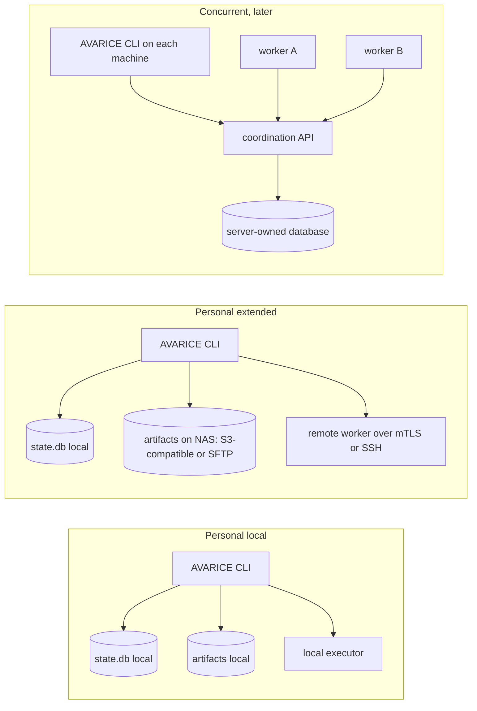

# Deployment and portability

> Status: proposal. Nothing described in this document is built yet; present tense describes the proposed design.

On day one AVARICE (Agent Verification, Automation, Runtime Integration, and Coordination Environment) is a Node CLI, a skill, a hook and one SQLite file per profile on the Mac's internal disk. Each later move (artifact bytes to a NAS, execution to a remote worker, coordination to a shared service) replaces one adapter behind an existing port. Moves that relocate data need an explicit data migration; the remote worker relocates none. Domain workflow code does not change (NFR-4). The database never moves onto a network filesystem (NFR-5, [ADR-003](decisions/ADR-003-local-persistence.md)).

## Local baseline

### What runs on the laptop on day one

| Item | Location | Installed by |
|---|---|---|
| CLI and library | `~/.local/share/avarice/app/<version>/`, shim at `~/.local/bin/avarice` | `npm install -g` from a tarball, or a copied bundle; no admin rights |
| Profile configuration | `~/.config/avarice/profiles/<profile>/config.json` | `avarice init --profile personal-local` |
| Profile data | `~/.local/share/avarice/<profile>/state.db`, `artifacts/`, `backups/` | created on first use |
| Repository settings | `<repo>/.avarice/config.json` (committed), `<repo>/.avarice/active-run` (git-ignored) | `avarice repo add` |
| Host integration | Skill and hook in the active Claude config directory, or the plugin | `avarice install-host` or plugin install |

Nothing listens on a port. Between runs nothing runs; during an unattended run the supervisor and the contained host invocation run. A sleeping Mac stops both: the run resumes as `paused` on wake, and computing during sleep needs the remote worker below. On Windows the data root follows `%LOCALAPPDATA%\avarice`; Windows and WSL are planned, not tested ([enterprise-adaptation.md](enterprise-adaptation.md#platform-support)).

### Offline matrix

| Capability | Offline | Notes |
|---|---|---|
| `status`, `doctor`, `export`, `backup`, `dashboard` | Yes | Reads local store; the dashboard is a local HTML file |
| `start` from a manual brief | Partly | Compiles and stores the contract; execution needs model access (see GSD planning and execution below) |
| Context pack from git files and `.planning/`, including intel and graph queries | Yes | External refs marked `stale` or `unavailable` |
| Index build: graph | Yes | `graphify update .` needs no model |
| Index build: intel refresh | No | Model invocation; the index stays absent or stale until reconnect |
| Context from tracker or remote docs | No | Reduced mode: paste the content as a manual brief |
| GSD planning and execution, attended or unattended | No | Needs model calls through the host; an unattended run that loses the network ends its current invocation as `inconclusive` and pauses |
| Decisions: answering, inbox, local notifications | Yes | Push adapters queue until reconnect; decisions stay open |
| `verify` (repository checks) | Yes, if the checks themselves need no network | Checks that download dependencies fail and are recorded as `failed`, not skipped |
| Approvals | Yes, recorded locally | Consumed only when the action runs |
| Privileged actions (push, PR) | No | Never queued for automatic replay (FR-15) |
| Resume after reconnect | Yes | Refreshes refs; asks before any privileged action |

## Topology evolution

## Local services deployment

The services in the topology above can also run on the developer's own machine, bound to `localhost`, through Docker Compose, Podman or native installs ([ADR-010](decisions/ADR-010-serverless-baseline-local-services.md)). The adapters and configuration are the ones a homelab uses; only the endpoint differs.

| Service | Local form | Port adapter | What it adds over the baseline |
|---|---|---|---|
| Artifact store | MinIO or another S3-compatible store | `ArtifactStore` (`s3`) | Exercises the NAS path before a NAS exists; no capability beyond local disk |
| Execution worker | A Linux container running the worker | `CommandExecutor` (`remote-worker`) | Checks that need Linux, on a Mac |
| Coordination service | The service with its own PostgreSQL | `Ledger` (`coordination-api`) | Several processes writing runs at once |
| Credential store | Vault or OpenBao, personal-extended profile only | `CredentialProvider` (`vault:`, named in [ADR-009](decisions/ADR-009-credential-broker.md)) | One store for local services and later homelab hosts |

Rules for this deployment:

- The baseline needs none of these services. A stopped or missing service degrades as an unreachable homelab service does (migration matrix below).
- Services bind to `localhost` only. AVARICE changes no DNS resolver, proxy or machine-wide package setting.
- In an enterprise profile, the deployment needs a yes to questionnaire question 25, and no local service replaces a company system of record ([enterprise-adaptation.md](enterprise-adaptation.md#onboarding-questionnaire)).
- Moving a service from `localhost` to a homelab host is an endpoint change, plus that service's migration command where it holds data.

## Migration matrix

| Move | Port | What changes | What does not change | Data migration | New risks |
|---|---|---|---|---|---|
| Local artifacts to NAS | `ArtifactStore` | Adapter `s3` (MinIO or a NAS S3 service) or `sftp`; credentials reference | Ledger, digests, workflows | `avarice artifacts migrate --to nas`: copy each blob, verify the digest on the target, update `artifacts.store`, delete local copy only after verification | NAS offline makes old logs unreadable; new writes fall back to local only if the profile allows it (`artifactFallback: "local"`), recorded per blob |
| Local execution to remote worker | `CommandExecutor` | Adapter `remote-worker`; worker endpoint and identity in config | Checks, evidence format, workflows | None; new runs only | Network trust boundary; workspace transfer; clock skew |
| Local checkpoints to shared coordination | `Ledger` | Adapter `coordination-api`; local SQLite becomes a read cache | Domain transitions, state machine | `avarice ledger migrate --to coordination`: export, import with `preserve-ids`, verify counts, switch adapter, keep the local file read-only for 30 days | Server availability now gates writes; offline mode drops to read-only plus local drafts |
| One session to concurrent sessions | `Ledger` leases | Lease TTL and renewal become load-bearing | Single-run semantics | None | Two agents on one run: second gets `conflict` and must take a different run |

### Local artifacts to NAS

Artifact bytes are content-addressed, so a blob can live anywhere and still be verified by recomputing its digest. Metadata stays in the local ledger. The `artifacts.store` column records which adapter holds each blob, so a partial migration is visible and resumable. AVARICE does not use an SMB or NFS mount as an artifact store by default, because it cannot verify atomic rename semantics on every NAS. A mounted path is allowed only with `"atomicRename": "verified"`, after `avarice artifacts probe` passes its rename and fsync test on that mount.

### Local execution to remote worker

The worker is a small service that accepts a `CommandSpec`, materializes a workspace at a given revision, runs the command and returns a `CommandResult` with output blobs.

| Concern | Design |
|---|---|
| Worker identity | Each worker has a key pair and a host record in the ledger: name, role, endpoint, key fingerprint, capability descriptor and status (FR-24). Endpoints are configured explicitly; no service discovery. A host cannot be deactivated while an active project or run depends on it. |
| Authentication | Mutual TLS with client certificates issued by a personal CA, or SSH with a forced command. Both pin keys; neither uses passwords. |
| Transport | TLS 1.3 or SSH. Verification is never disabled (SEC-5). |
| Command authority | The worker accepts only commands listed in the repository's `.avarice/config.json` checks at the requested revision, plus a fixed set (`git fetch`, `git checkout`). It refuses arbitrary argv. When the worker later hosts contained agent invocations, it generates the same sandbox and hook configuration from the contract on its own OS, and its `CapabilityDescriptor` reports the enforcement level it verified. |
| Workspace transfer | The worker fetches the revision from the SCM remote or receives a `git bundle` of the commits. Dirty trees are sent as a patch with its digest. Active working directories are never copied. |
| Capability negotiation | `GET /capabilities` returns a `CapabilityDescriptor`: OS, architecture, available toolchains, `cancel`, max concurrency. The adapter refuses checks whose declared `requires` (for example `os: darwin`) the worker lacks. |
| Network failure | Submit is idempotent by `invocation_id`. A lost response triggers `GET /invocations/<id>` before any resubmit. A worker that cannot report within the timeout yields `timeout` with `sideEffect: 'unknown'` and evidence `inconclusive`. |
| Cancellation | `DELETE /invocations/<id>` sends SIGTERM then SIGKILL on the worker; the result records which happened. |

### Path translation and workspace identity

| Concern | Rule |
|---|---|
| Identity | A workspace is `projectId` plus `rootCommit` plus a revision. Absolute paths are never stored in the ledger. |
| Paths in evidence | Relative to the workspace root, with `/` separators. |
| Checkout placement | Each machine configures its own `workspaceRoots`; the worker places checkouts under its own root keyed by `projectId` and `invocation_id`. |
| Case sensitivity | macOS default APFS is case-insensitive, Linux is case-sensitive. `repo add` warns when the repository contains paths that differ only by case. |
| Symlinks | Followed only inside the workspace root; a symlink pointing outside is reported and not read. |
| Executable bits | Preserved by git; patch transfer uses `git diff --binary` so modes travel. |
| Line endings and OS | Checks can declare `requires.os`. Evidence records `os`, `arch` and toolchain versions, because a pass on macOS arm64 does not prove a pass on Linux x86-64. |
| File locking | The worker never shares a checkout across invocations; no cross-host file locks are used. |

### Local checkpoints to shared coordination

A shared coordination service is needed only when more than one machine advances runs concurrently. It is a server that owns a PostgreSQL database and exposes the `Ledger` operations over HTTPS with the same optimistic version and fence semantics. Running SQLite on a NAS share instead is rejected: sqlite.org states WAL does not work over a network filesystem and network locking has been known to fail (https://www.sqlite.org/useovernet.html).

### Concurrent workers (later)

| Mechanism | Design |
|---|---|
| Claims | A worker claims a task with `claim(task, worker, ttl)`; the server returns a lease with a monotonically increasing fence token. |
| Heartbeats | Every `ttl / 3`; three missed heartbeats expire the lease. |
| Fencing | Every write carries the fence; the server rejects writes with an older fence. A worker that resumes after a pause learns it lost the lease on its next write. |
| Time | Lease expiry is computed by the server's clock only. Workers never compare their clocks with each other. |
| Retries | Bounded: three attempts with exponential backoff for duplicate-tolerant work (checks, context builds). Non-repeatable effects (PR creation, tracker comments, pushes) are never retried automatically; they go through reconciliation by idempotency key. |
| Recovery | An expired lease returns the task to `claimable`; the previous attempt's partial evidence stays attached and marked `inconclusive`. |

AVARICE does not claim exactly-once execution across external systems. It provides at-most-once initiation of each approved privileged action (single-use approval) and reconciliation by key for ambiguous outcomes.

## Backup consistency

Copying `state.db` while a command runs can copy the database without its `-wal` file and lose committed transactions (https://www.sqlite.org/wal.html). `avarice backup` therefore runs `VACUUM INTO '<backups>/state-<timestamp>.db'`, which produces a consistent snapshot, then copies the artifact blobs referenced at that moment. Artifact blobs are immutable, so copying them later is safe. A NAS backup target receives the snapshot file, not the live database. Time Machine copies of a live database are not treated as backups.

## Staging

| Stage | Built | Proved by |
|---|---|---|
| Now (MVP) | All port interfaces; local adapters; in-process fake remote adapters for `ArtifactStore` and `CommandExecutor` that serialize every call through JSON and inject latency, loss and duplicate responses | Portability proof: the workflow suite runs against local and fake-remote adapters with no domain change |
| Later, slice 6a | `s3` artifact adapter against a NAS or MinIO | Real deployment test: migrate 1,000 blobs, kill mid-migration, resume |
| Later, slice 6b | Remote worker service and adapter | Real deployment test over the home network, including Wi-Fi drop and laptop sleep |
| Later, slice 6c | Coordination service | Concurrency suite with two workers and injected pauses |
| Later, slice 6d | `vault:` credential adapter | Resolution against a sealed and an unsealed server; profile isolation of secret paths |

The portability proof shows that domain code depends only on ports, and that the workflow handles serialization, timeouts, duplicates and unknown side effects as specified. It does not prove TLS configuration, NAS filesystem semantics, real network partitions, worker OS differences or performance; those need the real deployment tests above.
