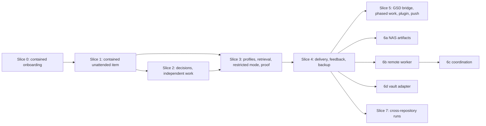

# Implementation plan

> Status: proposal. Present tense describes the proposed design. The onboarding of one existing repository is built; its behavior as built is described in [docs/system/](system/README.md), which is the source of truth for built behavior, and the differences are listed in [docs/system/findings.md](system/findings.md).

The AVARICE (Agent Verification, Automation, Runtime Integration, and Coordination Environment) plan has eight vertical slices, numbered 0 to 7. Slice 0 onboards one existing repository with GSD as the mapper, builds GSD's structured indexes for it, and builds the shared kernel (ledger, contract compiler, sandbox and hook generation, contained host adapter) on that use. Slice 1 is already a contained, unattended tool. It compiles a run contract from a brief and a policy preset, and runs one GSD unit headless inside the OS sandbox with fail-closed hooks and budgets. A GSD pause becomes a decision record instead of a guess. The repository's checks run through evidence gates, and the run resumes after a kill. Containment is not deferred to a hardening phase. Each later slice adds one capability and names the complexity it leaves out. Requirement IDs come from [requirements.md](requirements.md).

The implementation itself runs through GSD. The [GSD-compatible input](#gsd-compatible-planning-input) section shows how to feed this package to GSD 1.17.0.

## Scope tiers

| Tier | Contents | Slices |
|---|---|---|
| MVP requirements | Contained repository onboarding, contract, containment, budgets, unattended single and multi-item runs, decisions with local notification, gates and evidence, resume, profiles, restricted mode, `doctor`, delivery to a draft PR, backup, a static dashboard, an architecture model check | 0 to 4 |
| Portability contracts designed now | All ports ([list](contracts-and-state.md#ports)), capability descriptors, fake-remote adapters, contract suite | 0 to 3 (interfaces), 3 (proof) |
| Later additions | Review-only reconciliation (FR-23, catalog entry 13; unscheduled); GSD capability bridge, plugin, push notifiers (slice 5); NAS artifact adapter, remote worker, coordination service (slice 6); cross-repository runs and project groups (slice 7) | 5 to 7 |
| Enterprise decisions deferred to onboarding | Tracker, SCM other than GitHub, audit sink, policy file delivery, managed hook packaging, credential provider | Not planned; [enterprise-adaptation.md](enterprise-adaptation.md#onboarding-questionnaire) |

## Slices

### Slice 0: Contained onboarding of one repository

| | |
|---|---|
| Goal | `avarice onboard --policy onboarding` takes one existing local Git repository to an active project record, with GSD as the semantic mapper and GSD intel and graph indexes recorded, source read-only and writes confined to the staging worktree's `.planning/`, `graphify-out/` and `.avarice-knowledge/` ([repository-onboarding.md](repository-onboarding.md)) |
| Requirements | ONB-1, ONB-2, ONB-3, ONB-4, ONB-5, ONB-6 (detection and refusal; adoption flows in slice 3), ONB-7, ONB-8, ONB-9, ONB-12, ONB-13, ONB-14, FR-20, CON-2, CON-3, CON-5, CON-6, CON-13, SEC-5, NFR-1, NFR-2, NFR-3, NFR-5, NFR-6, NFR-9 |
| Deliverables | Package skeleton with import-boundary lint; ledger on `node:sqlite` with schema version 1 ([persisted entities](contracts-and-state.md#persisted-entities)); minimal `init` and registration for one profile; preflight; contract compiler with the `onboarding` preset; staging worktree; generated host settings with sandbox, `dontAsk`, `--setting-sources ""`, scrubbed environment; run hook set with `onFailure: "block"`; contained Claude Code host adapter; `GsdOnboarding` adapter for GSD 1.17.x (`inspect`, `probeState`, `planMapping` for full and fast, `startMapping`, `stamp`, `validateArtifacts`); artifact snapshot; index stage (sandboxed `graphify update .` chain, contained intel refresh, knowledge pass over stable documents merged into the graph, index validation); a first spike confirms three things: the knowledge corpus can be limited to the listed documents, where `/graphify` writes its output, and whether `graphify merge-graphs` keeps confidence tiers that GSD's built-in reader can read; `gsd-intel` and `gsd-graph` context adapters with `avarice context <term>` for attended queries; project record with index build commits, and activation with promotion `none`; `status` and `resume` for onboarding |
| Dependencies | Node 22.22.3 or newer; a Claude Code version admitted in [version compatibility](extensions.md#version-compatibility) (2.1.312, 2.1.316 and 2.1.317 today); GSD 1.17.0 |
| Verification | S-26, S-27, S-29, S-30, S-31, S-32, S-33 (fast map), S-35, S-36, S-39, S-40, S-45, S-46; AC-1; CS-1 to CS-4, CS-7, CS-10 to CS-14 adapted to the onboarding contract; resolve unresolved host limitations 1, 2, 5, 6 and 7 in [containment.md](containment.md#unresolved-host-limitations) |
| Excluded | Remote workers, NAS migration, the dashboard (slice 4), distributed scheduling, enterprise connectors, planning initialization (`ingest-docs`), path-scoped and incremental refresh, adoption of existing maps, promotion `copy` and `commit`, active command validation |

Exit criterion: one real brownfield repository reaches an active record that lists a graph with code and document nodes, and intel, built at the onboarded revision. A scripted source edit through Edit, Bash and Python is blocked, and so is a scripted edit of the policy file. Killing mapping and running `resume` reaches the same active record.

### Slice 1: Contained unattended run of one work item

| | |
|---|---|
| Goal | `avarice start --brief b.md --policy routine` takes one work item to `ready_for_review` without prompts, or to `blocked_on_decision` with a decision record, inside enforced containment, surviving a kill at any point |
| Requirements | RC-1, RC-2, RC-3, RC-4, RC-5, CON-1, CON-2, CON-3, CON-5, CON-6, CON-7, CON-8, CON-9, CON-13 (tool calls, invocations, wall clock, cost cap), CON-14, CON-16, AUT-2 (record only), AUT-7, AUT-8, AUT-9, AUT-12 (states and cancellation for one item), SEC-2 (scrubbed environment, no credentials in the run), FR-1, FR-2, FR-4 (Stage 1), FR-5, FR-6, FR-7, FR-11, NFR-1, NFR-3, NFR-5, NFR-6, NFR-9, OPS-2, ONB-10 |
| Deliverables | On the slice 0 kernel: contract compilation from a brief and G0; run worktree on a new branch; generated host settings with sandbox (`failIfUnavailable`, `allowUnsandboxedCommands: false`), `dontAsk`, `--setting-sources ""`, scrubbed environment; run hook set with `onFailure: "block"` (canonical paths, read-before-edit, tool-call reservation, Agent `permissionMode` denial, background Bash denial); Claude Code host adapter for `/gsd-quick --validate --text`; run-scoped GSD configuration; outcome classification; discard-and-retry for crashed invocations (CON-16); context packs from the four MVP adapters; checks, test inventory, gates G2 and G4; `status`, `inbox`, `resume`; `install-host` for the `avarice-run` skill |
| Dependencies | Slice 0; an active project record for the target repository; a spike confirming the sandbox runtime can wrap AVARICE's own check commands |
| Verification | Containment cases CS-1 to CS-4, CS-6, CS-7, CS-10 to CS-14 on the installed host; scenarios S-3, S-12, S-13, S-14, S-15, S-20, S-41, S-42; AC-3; baseline unattended workflow with a fake host; kill-point suite; resolve unresolved host limitation 8 in [containment.md](containment.md#unresolved-host-limitations); active validation of the repository's declared check commands (ONB-10) |
| Excluded | Several work items and independent scheduling, answering decisions and resuming GSD sessions, notifications beyond the local inbox, contract amendments (none exist yet, so RC-5 holds by absence), more than one profile, policy presets other than `routine` and `onboarding`, retrieval adapters beyond `git-files`, `gsd-planning`, `gsd-intel` and `gsd-graph`, push and PR delivery, Stage 2 capability |

Exit criterion: three R1 benchmark tasks on a real repository reach `ready_for_review` with no human input after start, and a scripted out-of-scope write through Bash, Python and Edit fails on each path.

### Slice 2: Decisions, independent work and amendments

| | |
|---|---|
| Goal | Runs with several work items continue independent work around an open decision, take a validated answer, resume the paused GSD session and finish |
| Requirements | AUT-1, AUT-2, AUT-3, AUT-4, AUT-5, AUT-6 (local), AUT-10, AUT-12, AUT-16, RC-6, RC-7, RC-8, CON-15 (subagent budget sharing) |
| Deliverables | Work-item scheduler with dependencies; work-item sizes and specifications with derivation from the brief, indexes and GSD plan; model per item from `modelBySize`; required checks after every item; authority-class matching and authorized defaults; `decide` with identity, duplicate and state-digest checks; resume through `claude -p --resume`; batching; local notifier and launchd digest scheduler; `contract amend` with evidence invalidation; gates G1 and G3; integrity gates for overrides and PRUNE; subagent concurrency reservation |
| Dependencies | Slice 1 |
| Verification | S-17, S-18, S-21, S-50, S-51, S-52; CS-5, CS-15; decision response validation suite; amendment invalidation tests |
| Excluded | Push notifiers, reply channels other than the terminal |

### Slice 3: Profiles, retrieval budgets, restricted mode and the portability proof

| | |
|---|---|
| Goal | Separate profiles, progressive retrieval with enforced caps, explicit degradation, and proof that domain code is adapter-independent |
| Requirements | ONB-6 (adoption), ONB-11, ONB-15, FR-22, SEC-1, SEC-2, SEC-3, SEC-4 (model), SEC-6, SEC-7, CON-4, CON-10, CON-11, CON-12, OPS-1, OPS-5, OPS-6, NFR-4 (proof), FR-3, FR-8, FR-12 to FR-19 |
| Deliverables | Onboarding: adoption and migration of existing GSD maps, path-scoped and incremental refresh with `verify codebase-drift` and the graph's structural diff selecting which map documents to refresh, incremental knowledge-pass refresh of changed documents with GSD phase files added, planning initialization through `ingest-docs`, promotion `copy` and `commit`, enterprise onboarding modes; profile resolver and repository binding; restricted mode with `--restricted` and a disposable copy; progressive retrieval and per-step caps; handle-first retrieval and per-edge read rules (FR-22), with the spike that maps graphify relations to read rules; the three-arm retrieval evaluation and the knowledge-pass default it decides; manual-equivalent commands (`context add`, `evidence add`, `pr record`, `comment --print`; FR-19); cache scoping; redactor; attended privileged-action hook and approvals; `doctor` with enforcement levels and `--extensions`; fake-remote `CommandExecutor` and `ArtifactStore`; shared contract suite package |
| Dependencies | Slices 1 and 2 |
| Verification | S-28, S-33 (scoped), S-34, S-37, S-38, S-47, S-49, S-54; AC-2; AC-8 with the three-arm evaluation; AC-14 on the brownfield benchmark; S-1, S-2 (without `backup`), S-4, S-5, S-7, S-9, S-16, S-22; resolve unresolved host limitations 3 and 4; CS-8, CS-9, CS-16; isolation suite (AC-6); portability proof (AC-7); redaction suite (AC-5) |
| Excluded | Real remote adapters, enterprise policy delivery |

### Slice 4: Delivery, test strength, review feedback and data safety

| | |
|---|---|
| Goal | From `ready_for_review` to a pushed branch and draft PR when the contract authorizes it, and back to a new attempt on review feedback, with no duplicate PRs |
| Requirements | AUT-11, AUT-13, AUT-14, AUT-17, SEC-8, FR-9, FR-10, FR-25, FR-26, NFR-7, NFR-8, OPS-3, OPS-4 |
| Deliverables | Push and draft PR by AVARICE outside the contained invocation; `ChangeRequests` adapter on `gh`; reconciliation on resume; feedback attempts; `avarice mutate`, the mechanical mutant generator for changed lines and the Node mutation probe (`mutants.toml`, four verdicts, integrity refusals); `harden` work items and the `hardening` preset; symbol-scope check in G2 from the code graph; architecture model draft and `architecture-model` check; `avarice dashboard` with `--watch`; `backup`, `restore`, `export`, `import`, `uninstall`, `gc`, retention |
| Dependencies | Slices 1 to 3 |
| Verification | S-6, S-8, S-19, S-23, S-24, S-25, S-48, S-53, S-56, S-57, S-58, S-59; AC-15; duplicate-retry suite (AC-4); mutation probe suite; restore drill (T-7) |
| Excluded | Merge, release, deploy |

This slice completes the MVP. The benchmark subset (16 R1 and 8 R2 tasks) runs at the end of this slice to measure AC-9, AC-12 and AC-13. AC-10 and AC-11 need the C1, C2 and X task classes and are measured with the full benchmark in slice 5.

### Slice 5: GSD capability bridge, phased work, plugin and push notifiers

| | |
|---|---|
| Goal | Gates inside GSD's loop; `/gsd-autonomous --only N` units; one-step install; notifications away from the desk |
| Requirements | FR-4 (Stage 2), AUT-6 (push), OPS-6 |
| Deliverables | `avarice-bridge` capability with contributions and blocking gates; integration test of the plan-phase double-execute path before enabling `/gsd-autonomous` units; plugin for attended use; `ntfy`, `pushover` and `telegram` adapters |
| Dependencies | Slice 4; a confirmed reading of the capability schema in the installed GSD version |
| Verification | GSD integration suite runs `loop render-hooks` for each point; full 40-task benchmark |
| Excluded | GSD versions outside the pinned range |

Revisit trigger: if GSD changes the capability schema or adds a headless mode before this slice starts, re-run the GSD investigation and update [ADR-006](decisions/ADR-006-unattended-delegation.md) first.

### Slice 6: Personal infrastructure (later, each part independent)

| Part | Deliverable | Verification | Excluded |
|---|---|---|---|
| 6a | `s3` artifact adapter and `artifacts migrate` | S-10 against MinIO or the NAS | SMB and NFS mounts |
| 6b | Remote worker running checks and, after its own containment suite passes, contained agent invocations; host records with a deactivation guard (FR-24) | S-11 over the home network, including Wi-Fi loss; CS-1 to CS-16 on the worker OS | Concurrent workers |
| 6c | Coordination service and `coordination-api` ledger adapter | Concurrency suite with two workers and injected pauses | Multi-user access control |
| 6d | `vault:` credential adapter for the personal-extended profile ([ADR-009](decisions/ADR-009-credential-broker.md)) | S-55 against a local or homelab Vault or OpenBao, sealed and unsealed | Enterprise profiles, dynamic secrets |

Each part starts only when a measured need exists. For 6a that is disk pressure. For 6b it is runs that must continue while the Mac sleeps, or checks that cannot run on macOS. For 6c it is two machines advancing runs at once. For 6d it is a second machine or a local service that needs the same secrets. The parts are independent except 6c, whose concurrency suite needs workers from 6b. Each part may also run on the developer's own machine on `localhost`, with the same adapter and migration ([ADR-010](decisions/ADR-010-serverless-baseline-local-services.md)); placement does not change the trigger.

### Slice 7: Cross-repository runs and project groups (later)

| | |
|---|---|
| Goal | One unattended run spans several repositories of a project group and ends with one linked change request per repository ([cross-repository runs](autonomy-and-decisions.md#cross-repository-runs-later)) |
| Requirements | AUT-15, FR-21 |
| Deliverables | Project groups in `inventory` and a ledger migration; contracts with one workspace per repository; cross-repository work-item dependencies; per-repository gates and delivery with linked change requests; the standards context adapter ([extensions.md](extensions.md#12-standards-context-adapter-later)) |
| Dependencies | Slice 4; an active project record for each member repository |
| Verification | S-43, S-44; the containment suite with two worktrees in one run |
| Excluded | Coordinated merging, cross-profile groups |

Starts when two repositories regularly need changes together, measured from the user's own runs.

## Dependency graph



## Maintenance cost

The ongoing cost is an estimate based on the surfaces AVARICE depends on.

| Source of change | Frequency (estimated) | Work per change |
|---|---|---|
| GSD minor releases | Unknown. The installed 1.17.0 ships 12 installer migration modules ([inventory](existing-tooling-assessment.md#gsd)); inferred, not measured: install formats change often enough to plan for several breaking upgrades per year | Re-run the GSD integration suite and the outcome classifier fixtures (text-mode output); Stage 2: re-check the capability schema |
| Claude Code releases | Frequent | Re-run the containment suite against the new version before enabling unattended runs on it; `doctor` pins the last verified version |
| Node major releases | Yearly | Re-run all suites; `node:sqlite` API check |
| Schema migrations | One per feature that adds persisted data | Migration plus fixture |
| Each enterprise adapter | Per employer | Owned by the employer package; contract suite keeps it honest |

The containment suite is likely the most expensive recurring cost (an estimate, not measured): it runs real headless invocations and spends model budget on every host upgrade.

## GSD-compatible planning input

GSD 1.17.0 can bootstrap `.planning/` from existing documents with `/gsd-ingest-docs`, which classifies files as ADR, PRD, SPEC or DOC and accepts a manifest (`workflows/ingest-docs.md:7, 112`). This package ships [gsd-ingest-manifest.yaml](gsd-ingest-manifest.yaml) for that command:

```text
/gsd-ingest-docs docs --manifest docs/gsd-ingest-manifest.yaml
```

The slices map onto GSD roadmap phases in the format of `gsd-core/templates/roadmap.md`. The first three are shown; the rest follow the same pattern from the tables above.

```markdown
### Phase 0: Contained onboarding of one repository
**Goal**: avarice onboard takes one existing repository to an active project record with GSD as the mapper, source read-only
**Depends on**: Nothing (first phase)
**Requirements**: [ONB-1, ONB-2, ONB-3, ONB-4, ONB-5, ONB-6, ONB-7, ONB-8, ONB-9, ONB-12, ONB-13, ONB-14, FR-20, CON-2, CON-3, CON-5, CON-6, CON-13, SEC-5, NFR-1, NFR-2, NFR-3, NFR-5, NFR-6, NFR-9]
**Success Criteria** (what must be TRUE):
  1. One brownfield repository reaches an active project record
  2. Source edits and policy edits during mapping are blocked
  3. An interrupted mapping resumes to the same active record
  4. The active record lists a graph with code and document nodes, and intel, built at the onboarded revision
**Plans**: TBD

### Phase 1: Contained unattended run of one work item
**Goal**: avarice start takes one work item to ready_for_review without prompts, or to blocked_on_decision, inside enforced containment
**Depends on**: Phase 0
**Requirements**: [RC-1, RC-2, RC-3, RC-4, RC-5, CON-1, CON-2, CON-3, CON-5, CON-6, CON-7, CON-8, CON-9, CON-13, CON-14, CON-16, AUT-2, AUT-7, AUT-8, AUT-9, AUT-12, SEC-2, FR-1, FR-2, FR-4 (Stage 1), FR-5, FR-6, FR-7, FR-11, NFR-1, NFR-3, NFR-5, NFR-6, NFR-9, OPS-2, ONB-10]
**Success Criteria** (what must be TRUE):
  1. Three routine tasks reach ready_for_review with no human input after start
  2. An out-of-scope write through Edit, Bash and Python fails on every path
  3. A broken hook or missing sandbox blocks the protected operation
  4. Killing the supervisor and running avarice resume continues from the last checkpoint
**Plans**: TBD

### Phase 2: Decisions, independent work and amendments
**Goal**: Runs continue independent work around an open decision, take a validated answer, resume the paused GSD session and finish
**Depends on**: Phase 1
**Requirements**: [AUT-1, AUT-2, AUT-3, AUT-4, AUT-5, AUT-6, AUT-10, AUT-12, AUT-16, RC-6, RC-7, RC-8, CON-15]
**Success Criteria** (what must be TRUE):
  1. A blocking question on one item leaves an independent item completed with evidence
  2. Silence and a failing notifier leave the decision open
  3. A stale answer is re-opened rather than applied
**Plans**: TBD
```

Slices 0 and 1 suit `/gsd-mvp-phase`, which plans a phase as a vertical MVP slice (`~/.claude/gsd-core/workflows/mvp-phase.md`).
