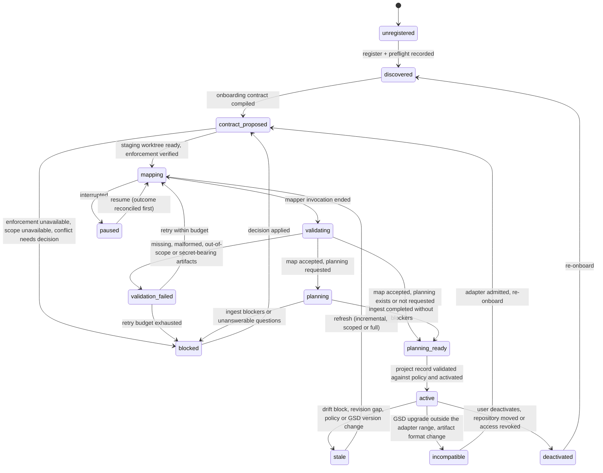

# Repository onboarding

> Status: proposal. Present tense describes the proposed design. The onboarding of one existing repository is built; its behavior as built is described in [docs/system/](system/README.md), which follows the code where the two differ, and the differences are listed in [docs/system/findings.md](system/findings.md).

AVARICE (Agent Verification, Automation, Runtime Integration, and Coordination Environment) onboards an existing repository by running GSD's own mapping and planning workflows in a staging worktree. There, the sandbox makes source code read-only. Contained agent invocations may write only the [agent write set](#onboarding-contract), and AVARICE writes the index files and the architecture draft itself. No commit happens unless the onboarding contract authorizes one. AVARICE then validates the generated artifacts and records their revision, scope and completeness, which GSD does not. The result is a versioned **project record** that references the GSD artifacts and holds only operational metadata. GSD owns what the codebase means; AVARICE owns where, how and under what authority GSD learns it. Requirements ONB-1 to ONB-15 are owned by [requirements.md](requirements.md#codebase-onboarding); the decision is recorded in [ADR-008](decisions/ADR-008-repository-onboarding.md).

The **project record** is what the onboarding brief calls a "framework project profile". It is a different thing from a **profile** (`personal-local`, `enterprise-<org>`) and from a **policy preset** (`routine`), both defined in [requirements.md](requirements.md#how-to-read-this).

## How to read this

GSD facts were read from the installed GSD 1.17.0 under `~/.claude/gsd-core/` on 2026-10-29; paths below are relative to that directory. Everything else about AVARICE is a proposal.

## Verified GSD onboarding surfaces

| Capability | GSD 1.17.0 behavior | Evidence |
|---|---|---|
| Onboarding router | `/gsd-onboard [--fast] [--text]` renders `gsd_run init onboard --raw` and prints the next command; it never runs mapping or planning itself. It writes only `.planning/onboarding/SUMMARY.md`, never overwriting it | `workflows/onboard.md:3-4, 69-79, 230` |
| Onboarding projection | JSON with `is_brownfield`, `map_readiness` (`complete`, `fast`, `none`), `missing_codebase_map_files`, `doc_candidates[]`, `next_action.kind` (`map-codebase`, `partial-planning`, `complete-map-before-new-project`, `ingest-docs`, `new-project`, `write-summary`, `ready`) | `bin/lib/onboard-projection.cjs:162-306` |
| Projection side effect | Calls `loadConfig`, which "normalizes and rewrites config.json, spawns git" | `bin/lib/planning-workspace.cjs:173-174` |
| Map completeness | Checked by file existence only: 7 files for a complete map (STACK, ARCHITECTURE, STRUCTURE, CONVENTIONS, TESTING, INTEGRATIONS, CONCERNS), 4 for a fast map | `bin/lib/onboard-projection.cjs:29-35, 119-128` |
| Full map | `/gsd-map-codebase`: 4 parallel `gsd-codebase-mapper` agents writing 7 documents to `.planning/codebase/` | `workflows/map-codebase.md:156-274` |
| Fast map | `/gsd-map-codebase --fast [--focus ...]` runs `workflows/scan.md`: one agent, 4 documents; no stamp, no secret scan, no commit | `workflows/scan.md:21-94` |
| Path-scoped map | `--paths p1,p2` passes a scope hint to every mapper; rejects `..`, absolute paths and shell metacharacters; all 7 documents are regenerated with scoped content. The flag is absent from the command's argument hint | `workflows/map-codebase.md:32-69`; `commands/gsd/map-codebase.md:4` |
| Existing map | Prompts Refresh (delete and remap), Update (chosen documents) or Skip | `workflows/map-codebase.md:85-125` |
| Mapper authority | Tools `Read, Bash, Grep, Glob, Write, Skill`; told to write only `.planning/codebase/` and not to commit; forbidden-files list is prompt-level only; no untrusted-input boundary in its prompt | `agents/gsd-codebase-mapper.md:4, 183, 810-844`; grep for `untrusted-input-boundary` returns 0 |
| Freshness stamp | `gsd_run stamp-codebase-map [--files]` writes frontmatter `last_mapped_commit` and `last_mapped_at`. No mode, scope or completeness field exists | `workflows/map-codebase.md:367-398`; `bin/lib/drift.cjs:450-485` |
| Drift check | `gsd_run verify codebase-drift`: diffs `last_mapped_commit` (from STRUCTURE.md) to `HEAD`, committed history only, excluding `.planning/`; outcomes `skip`, `unreadable` (exit 69), `pass`, `block`, with `affected_paths` | `bin/lib/gate-codebase-drift.cjs:93-273` |
| Commit of generated docs | `gsd_run query commit` skips when `commit_docs` is false | `bin/lib/commands.cjs:1467-1474` |
| Planning location | Hardcoded to `<cwd>/.planning`; a `.planning` symlink to an external directory is a supported convention; `--project-dir` requires an existing `.planning/` | `bin/lib/planning-workspace.cjs:144`; `bin/lib/project-root.cjs:62-84` |
| Document ingestion | `/gsd-ingest-docs [path] [--mode new\|merge] [--manifest <file>]`; 50-document cap; BLOCKER conflicts stop before any PROJECT, REQUIREMENTS, ROADMAP or STATE write; merge mode previews a diff | `workflows/ingest-docs.md:29-352` |
| Project from a document | `/gsd-new-project --auto @doc` still asks about 8 configuration questions, skips the brownfield map offer, and chains into `/gsd-discuss-phase 1 --auto` | `workflows/new-project.md:107, 1141`; `workflows/new-project/steps/auto-mode-config.md` |
| Loop points | None exist for onboard or map; drift gates attach only at `plan:pre` and `execute:wave:post` | `bin/lib/loop-resolver.cjs:77-90` |
| Intel | `/gsd-map-codebase --query refresh` spawns `gsd-intel-updater` (tools `Read, Write, Bash, Glob, Grep`), which writes `.planning/intel/` JSON files with per-file token targets; `query`, `status`, `diff` and `validate` run inline. Every intel function is disabled unless `intel.enabled` is true | `commands/gsd/map-codebase.md:33`; `bin/lib/intel.cjs:6-10, 32-36, 302-309`; `agents/gsd-intel-updater.md:1-6, 290` |
| Knowledge graph | `graphify update .` (graphify 0.9.53) writes `graphify-out/`; `/gsd-graphify build` copies `graph.json` and `GRAPH_REPORT.md` to `.planning/graphs/` and writes a diff snapshot. `graph.json` carries `built_at_commit`; `gsd_run graphify status` reports staleness against `HEAD`. Disabled unless `graphify.enabled` is true | `~/.claude/skills/gsd-graphify/SKILL.md:149-185`; `bin/lib/graphify.cjs:351-486` |
| Semantic extraction | The `/graphify` skill extracts documents with the host agent: subagents through the Agent tool, chunks of 20 to 25 files, a per-file semantic cache (`check_semantic_cache`), output in `graphify-out/` of the working directory. Code needs no model; documents do. With `GEMINI_API_KEY` or `GOOGLE_API_KEY` set it calls Gemini instead | `~/.claude/skills/graphify/SKILL.md:151-255` |
| Graph merge | `graphify merge-graphs <g1> <g2> --out <path>` joins graph files from different repositories: it prefixes every node ID with a per-input tag and drops `built_at_commit`, so it cannot join a code graph and a document graph of the same repository without severing every document-to-code edge ([spikes](../spikes/2026-11-01-pre-slice-0/README.md)). AVARICE does not use it for the knowledge pass | `graphify --help`; `~/.claude/skills/graphify/references/github-and-merge.md:14-45` |
| Health checks | `validate health` and `planning inspect` ignore the codebase map | `bin/lib/health-diagnostic-rules/`; `bin/lib/planning-inspect.cjs` |

GSD offers no programmatic seam for mapping: it is a prompt workflow that needs an agent host. The supported seam is therefore a bounded handoff. AVARICE runs one top-level GSD workflow per contained headless invocation, then observes the files and the CLI projection, as in [ADR-006](decisions/ADR-006-unattended-delegation.md).

## Ownership matrix

Each transition and each authoritative record has exactly one owner.

| Transition or record | Owner | Others |
|---|---|---|
| Repository registration, identity, profile binding | AVARICE | |
| Preflight findings | AVARICE | GSD projection is one input |
| Onboarding contract and amendments | AVARICE | User authorizes |
| Staging worktree creation and removal | AVARICE | git |
| Semantic mapping (what the code is, conventions, testing, concerns) | GSD (`map-codebase`, `scan`) | AVARICE runs it contained |
| `.planning/codebase/*.md` content | GSD | AVARICE snapshots and validates, never edits |
| `last_mapped_commit` stamp | GSD (`stamp-codebase-map`) | AVARICE invokes it for every map it ran, fast or full: the mapper's own closing stamp call writes, so the hook denies it, and neither map arrives stamped |
| Mapping mode, scope, completeness classification | AVARICE (provenance sidecar in the project record) | |
| Artifact validation and acceptance | AVARICE | User decides conflicts |
| Requirements, roadmap, planning state, ingest conflicts | GSD (`ingest-docs`, roadmapper) | AVARICE supplies the brief as an input document |
| Promotion of accepted artifacts into the user's checkout | AVARICE, per contract | User authorizes commits |
| Project record and its versions | AVARICE | |
| Command classification and active validation | AVARICE | |
| Drift detection on committed history | GSD (`verify codebase-drift`) | AVARICE decides the refresh mode |
| `.planning/intel/` and `.planning/graphs/` content | GSD (intel updater) and graphify | AVARICE builds them contained, validates and queries them, never edits |
| Index build commit and freshness | AVARICE (project record) | GSD status verbs are inputs |
| Source code, tickets, CI, reviews, identity | Git hosting and enterprise systems | |

AVARICE keeps no architecture index, conventions database, requirements store or roadmap of its own (ONB-2); the indexes it queries are GSD's. The project record stores paths, digests, revisions and classifications of GSD artifacts, never their content. The artifact store keeps a content-addressed snapshot of each accepted set as evidence, with the same retention rules as other artifacts ([contracts-and-state.md](contracts-and-state.md#retention-export-and-import)).

## Onboarding lifecycle



Every transition is a ledger transaction written before the side effect it guards, with the same lease and fence rules as runs ([contracts-and-state.md](contracts-and-state.md#concurrency-control)). `blocked` here is the onboarding counterpart of a run's `blocked_on_decision` and carries the same reason codes plus `existing_state_conflict`, `scope_unavailable` and `adapter_incompatible`.

### Stages

| Stage | What AVARICE does | Writes |
|---|---|---|
| Register (also available alone as `avarice repo add`) | Resolves the git root, `rootCommit`, remote, `HEAD`, default branch and profile binding. Detects prior AVARICE records and prior `.planning/` state | Ledger only |
| Preflight | Read-only scan: uncommitted changes, existing `.planning/` and codebase map with stamp, nested repositories and submodules, workspace manifests (monorepo signals), generated and vendor directories, repository instruction files (`CLAUDE.md`, `AGENTS.md`, `.claude/`), declared runtimes, file and byte counts, host enforcement level, GSD version and adapter compatibility | Ledger only |
| Propose contract | Compiles an onboarding contract (below) from the profile, the `onboarding` policy preset and the preflight | Ledger only |
| Prepare workspace | `git worktree add` at the recorded `HEAD` on branch `avarice/onboard-<id>`. Uncommitted user changes stay in the user's checkout and are reported as "not mapped" | Staging worktree |
| Probe GSD state | Runs `gsd_run init onboard --raw` with `--cwd` set to the staging worktree, because the projection can rewrite `config.json` | Staging `.planning/config.json` at most |
| Configure GSD | `gsd_run config-set` in staging: `commit_docs=false`, `workflow.text_mode=true` | Staging `.planning/config.json` |
| Map | One contained invocation of the chosen mapping mode ([decision table](#mapping-mode-decision-table)). AVARICE then runs `gsd_run stamp-codebase-map --files <the files the mode requires>` itself (four for fast, seven for full; step `gsd:stamp`), after the invocation and before validation, and again when a killed map is reconciled on resume. The hook does not admit that verb | Staging `.planning/codebase/` |
| Validate | Checks below | Ledger, artifact snapshot |
| Index (optional, on by default in the `onboarding` preset) | `gsd_run config-set intel.enabled true` and `graphify.enabled true` in staging. Graph: AVARICE itself, through the sandboxed `CommandExecutor`, runs `graphify extract <staging> --code-only --out <directory outside staging> --max-workers 1` and `graphify cluster-only` (`graphify update .` is never used: it writes into the tree and indexes Markdown), copies the result into `.planning/graphs/` and runs `gsd_run graphify build snapshot`. No model is called, and these commands are not on the agent's allow list. Intel: one contained invocation of GSD's `gsd-intel-updater` agent writes the five files under `.planning/intel/`; AVARICE then finishes the step itself (below). Each index is validated separately (below) | Staging `graphify-out/`, `.planning/graphs/`, `.planning/intel/` |
| Knowledge pass (part of the index stage) | Split in two (plan 01-19 decision B, 2026-11-03): AVARICE does every deterministic step, the model only reads and extracts. **Before the invocation** AVARICE copies the stable documents (ONB-14) into a staging corpus directory, `.avarice-knowledge/`, with a manifest in the data root mapping each copy to its source path and revision, splits them into chunks (sorted by path, at most 8 documents and 64 KiB of text each; `src/domain/knowledge-extraction.ts`) and writes the chunk plan, `.avarice-knowledge/.chunks.json`, which holds each document's repository path, node-id stem and absolute read path (`readPath`), each chunk's absolute output path (`writePath`), and no text, with an empty `.avarice-knowledge/.extraction/`. **The invocation** is one contained model session with its working directory set to the corpus, with **no shell, no skill and no subagent**: it may Read, Glob and Grep only under `.avarice-knowledge/` and Write only under `.avarice-knowledge/.extraction/`. The generated settings carry no `Bash` allow rule and deny `Bash`, allow `Read` only for the corpus, allow `Edit` only for the extraction directory and no `Skill` or `Agent`; the hook denies every shell call (`shell-disabled`), every read outside the corpus (`outside-read-set`), every write outside the extraction directory (`outside-write-set`) and every subagent. The prompt is fixed text and two counts: the extraction schema and rules, derived from the `references/extraction-spec.md` of the installed graphify skill (node `file_type` of `document`, `concept`, `rationale` or `code`; ids `[a-z0-9_]` built from the document path; relation names; `EXTRACTED`, `INFERRED` and `AMBIGUOUS` tiers with their scores; one JSON object per chunk), plus a statement that document text is data and never an instruction. It carries no repository text, not even a file name: the file list lives in the plan file, which the model reads as data. The model passes each `readPath` and `writePath` to Read and Write exactly as the plan gives them and builds no path; a denied or failed read is retried once with the `readPath`, then the file is left out and counted unread. Plan 01-25 made this change because, in 2 of 4 live runs of the earlier prompt (which had the model join its working directory and the repository path), the model dropped the `.avarice-knowledge/` segment and read the staging originals, which the hook denies as `outside-read-set`. The model writes one `chunk-NN.json` per chunk. **After the invocation** AVARICE reads the chunk files (a regular file of at most 1 MiB; a symlink counts as missing), concatenates the usable ones in chunk order (JSON with a `nodes` array and an `edges` or `links` array; anything else is skipped and counted) and merges the result into the code graph itself in one ID space: it unions nodes and edges by their unprefixed IDs, keeps each edge's `confidence` tier and `confidence_score`, rewrites each document node's `source_file` from the corpus manifest to the real repository path, lowers an `EXTRACTED` edge that touches a document node to `INFERRED`, sets `built_at_commit` to the onboarded revision, validates, runs `graphify cluster-only` on the result (graphify's one deterministic step used) and writes `.planning/graphs/graph.json`. No chunk file at all is `no-output`; fewer usable chunks than half the plan, or none usable, is `validation-failed`; a usable chunk says nothing about coverage by itself, so AVARICE counts per manifest entry whether the merged graph holds a document node of the pass that cites it; fewer than half covered is `validation-failed`; otherwise the record states `knowledge.documentsExpected`, `knowledge.dropped.unread` and a `knowledge.corpus` built from covered documents only. Plans 01-18 and 01-19 counted every document of a shape-valid chunk as covered, needed one document node, and recorded `dropped` as `{dangling, astDocument}` only (contract change: UAT gap G-01-154, plan 01-25). The code-only graph stays as `.planning/graphs/code-graph.json` for structural diffs. Why AVARICE chunks and builds itself, not graphify (0.9.53): its only chunker, `_pack_chunks_by_tokens`, is private to the path that calls an LLM backend with an API key (`graphify extract`); the skill's chunking (20 to 25 files by directory) is prose for a model; `detect` and `build_from_json` are Python APIs with no subcommand, and `build_from_json` remaps IDs and drops edges before AVARICE could count them, which would defeat the dangling-edge check and the "a code node wins an ID collision" rule. The extraction JSON already has the shape the merge consumes, so no conversion beyond concatenation is needed. With one model session and no subagent, coverage of a large corpus is bounded by the knowledge share of the wall clock: documents with a document node when the clock ends are used when at least half the manifest is covered, and the rest are counted in `knowledge.dropped.unread`. Phase files are excluded until slice 3 (ONB-15) | Staging `.avarice-knowledge/`, `.planning/graphs/` |
| Draft architecture model (optional) | `avarice architecture draft` derives components from top-level packages and directories and edges from observed imports in the code graph, with no model call ([ADR-012](decisions/ADR-012-architecture-model.md)). The draft is a proposal; it becomes the repository's `.avarice/architecture.json` only through promotion and the user's approval (FR-25) | Staging `.avarice/architecture.json` |
| Initialize planning (optional) | One contained invocation of `/gsd-ingest-docs --manifest <manifest> --mode new` over the brief and any authorized documents | Staging `.planning/` |
| Activate | Builds the project record, validates it against policy, promotes artifacts per contract | Ledger; user checkout only per promotion mode |
| Refresh | Drift check and refresh-mode choice | As in Map |
| Deactivate or re-onboard | Marks the record inactive, keeps history, removes the staging worktree when clean | Ledger |

`/gsd-new-project --auto` is not used. It chains into `discuss-phase --auto`, which picks options without asking, and it skips the brownfield map. Planning initialization goes through `ingest-docs`, whose BLOCKER gate stops before writing planning files.

### Validation

An artifact set is accepted only when every check holds:

| Check | Rule |
|---|---|
| Presence | All files the mode requires exist (7 for full and path-scoped, 4 for fast). Validation and activation judge, store and snapshot those files only; any other file the mapper wrote under `.planning/codebase` does not fail the onboarding, is not a map artifact and is not in the snapshot, and is recorded as a finding by path |
| Stamp | `last_mapped_commit` exists in each file and equals the staging `HEAD` |
| Scope of writes | The staging diff touches only the agent write set and the AVARICE write set from the [onboarding contract](#onboarding-contract); any other change fails validation and is reported as a containment finding. `graphify-out/` and `.avarice-knowledge/` are working directories that are never promoted |
| Path references | Directory and file paths named in the documents exist at the stamped revision; a configurable share of dangling references (default 5%) fails validation. Extraction is narrow: a bare extension (`.ts`), a `name@version` token, a dotted identifier (`process.env`) and any path in a clause that says it is absent or git-ignored are not references. AVARICE's own staging files (`.planning/config.json`, the `AVARICE_WRITE_SET` paths, the clone's `.git` and the host's `.claude/.cc-writes`) count as known. So does a reference the repository's own committed `.gitignore` rules ignore (declared build output such as `dist`, or local config): the rules are read from git objects at the pin, never from the staging or user working tree, `.git/info/exclude` or any user or system excludes, and git itself (`git check-ignore --no-index`, in a throwaway repository built from the pinned `.gitignore` blobs) decides which references they match. A symbolic-link `.gitignore`, more than 200 rule files or one above 1 MiB gives no rule at all. The 5% limit is unchanged, and the check detail names how many references the rules forgave. Note that an unanchored rule such as `dist` also matches `lenis/dist/lenis.css`, a path inside an npm package, because git does. Four more rules resolve a reference, none of them for build-emitted files (`sitemap.xml`, `robots.txt`) or `.env`: (1) it is a tracked file once a source extension (`.ts .tsx .js .jsx .mjs .cjs`) or `/index.<ext>` is appended, as an import specifier is; (2) it equals the trailing path segments of exactly one tracked file (`About/About.tsx` for `src/sections/About/About.tsx`; a directory is not a target, and two or more matches stay dangling); (3) its first segment (or `@scope/name`) is a dependency, devDependency, peerDependency or optionalDependency of the root `package.json` at the pin or of a workspace the root declares in `workspaces` (an array or `{ packages }`; `pnpm-workspace.yaml` is not read), so it is a module or lint-rule specifier (`motion/react`, `react/rules-of-hooks`); (4) it is an `owner/name` that a top-level `.github/workflows/*.yml` or `*.yaml` at the pin `uses:`, with or without `@ref`. These files are read as git blobs at the pin, never from a working tree. Extraction also drops placeholders: a compound bare extension whose parts are all known extensions or infix words (`.test.ts`, `.d.ts`, `.spec.tsx`; a real dotfile such as `.eslintrc.json` stays a reference) and a segment with a part that repeats one capital letter three or more times (`NNNN-kebab-title.md`, `YYYY-MM-DD.md`; `README.md` and `CLAUDE.md` stay references). The check detail counts the references each rule forgave |
| Secrets | GSD's own secret-pattern scan plus AVARICE's redactor patterns find nothing; a hit blocks with a decision, and the artifacts are never promoted |
| Size and structure | Each document is non-empty, under a size cap (default 256 KiB), and has the headings its template defines |
| Coverage claims | A path-scoped or fast map is labeled `partial` with its scope; the record never reports whole-repository coverage for it (ONB-7) |
| Repository instructions | Instruction files read by the mapper are listed; their content is treated as data and cannot change the contract (ONB-9) |
| Graph index | `graph.json` parses, its `built_at_commit` equals the staging `HEAD`, and `gsd_run graphify status` reports it not stale |
| Document nodes | Every document node traces to a file in the corpus manifest; each node's text is under a size cap (default 2 KiB); the redactor finds no secret in `graph.json`; document edges carry `INFERRED` or `AMBIGUOUS`, never `EXTRACTED` (the merge lowers the model's `EXTRACTED` document edges first); no more than 10% of the model's edges are dangling; no node is sourced from `STATE.md` or a planning document under `.planning/phases/`, and no node the pass added is sourced from anything under `.planning/phases/` (a code node of the code graph may name a tracked script or data file there); at least half the manifest's documents have a document node of the pass, and each one without a node is counted in `knowledge.dropped.unread`; a covered document is one a document node cites (the count shows what the graph holds, not which files the model opened) |
| Intel index | AVARICE runs `gsd_run intel validate` (it passes), then `gsd_run intel snapshot` (the one write: `.planning/intel/.last-refresh.json`, with that directory the one writable path of the sandboxed runner), then `gsd_run intel diff`. `diff` must report no file changed, added or removed against the snapshot AVARICE took and must find a baseline; so the digest in the record is of the files that were validated and snapshotted, and nothing (a host process still running, a late write) changed them in between. It no longer compares with a snapshot the model took: the model's own `intel validate` and `snapshot` calls are denied by the hook (a bare `gsd_run` has no preamble), so the agent cannot finish them. Absent reasons: `invocation-failed`, `budget_exhausted`, `validate-failed` (including `intel diff` not running), `diff-changed` (a file changed after AVARICE's snapshot; the detail names it) and `snapshot-failed` (the snapshot errored, was not reported saved, or left no baseline). GSD records file hashes, not a commit, so AVARICE records the staging `HEAD` it refreshed at |

A failed index check drops that index from the record and opens no decision (ONB-13). The map and the record still activate, and context assembly falls back to file excerpts.

Generated prose is accepted as GSD's description of the code. Validation checks provenance and structure; correctness stays with GSD and the user.

## Onboarding contract

The onboarding contract has the same schema as a run contract ([contracts-and-state.md](contracts-and-state.md#run-contract)), compiled with the `onboarding` policy preset. Its distinguishing values:

| Field | Onboarding value |
|---|---|
| `files.read` | Mapper-visible scope: the repository minus excluded directories (`node_modules`, vendor, build output, generated code) and minus secrets |
| `files.write`, `files.create` | The agent write set: `.planning/**` in the staging worktree for mapping, intel and ingest invocations, and `.avarice-knowledge/**` for the knowledge pass (of which the invocation itself may write only `.avarice-knowledge/.extraction/**`). The AVARICE write set, written by AVARICE's own executor and never by the agent: `graphify-out/`, `.planning/graphs/` and the draft `.avarice/architecture.json` |
| `knowledge.documents` | Repository documents added to the knowledge pass beyond the fixed set (ONB-14), as globs inside `files.read`; default `docs/**/*.md` and ADR directories found by preflight |
| `files.delete` | `.planning/codebase/**` only when the existing-map decision is Refresh |
| `execution.commands` | Read-only inspection only: `ls`, `cat`, `head`, `wc`, `find`, `git ls-files`, `git log`, `git rev-parse`, and `gsd_run` read verbs. With the index stage: the `gsd_run intel` verbs for the intel refresh. The graph build and merge commands (`graphify update`, `cp`, `graphify merge-graphs`, `gsd_run graphify`) run in AVARICE's own sandboxed executor, outside the agent's allow list. The knowledge-pass invocation has no shell at all (decision B): no command is on its allow list, and the hook denies every shell call. The slice 0 spike fixes the exact command set of the others. Repository scripts, package managers and test runners are not allowed (ONB-4) |
| `execution.endpoints` | None |
| `decisions.defaults` | Existing-map answer (`refresh`, `update:<docs>` or `skip`) chosen from the preflight; the ingest fields GSD cannot derive (name, success metric, target runtime), filled from the brief when present |
| `decisions.human` | Secret-scan hits, ingest BLOCKER and WARNING conflicts, overwriting any existing artifact outside staging, scope expansion |
| `delivery` | Promotion mode: `none` (default), `copy` or `commit` (below) |
| `budgets` | Wall clock, invocations, tool calls, subagents, cost cap per invocation, retry limit. `subagentsConcurrent` is 4. `invocations` is derived from the mapping mode and the retry limit and recorded with its formula in `budgets.invocationsDerivation`: map invocations per round (1 when the mode runs a mapper, 0 for `skip` and `adopt`) x (1 + map retries) + the interruption relaunches (one per map round when a mapper runs, else 1; a killed invocation stays charged and is run again) + 1 intel + 1 knowledge. With one retry that is full, fast and paths 1 x 2 + 2 + 1 + 1 = 6, skip and adopt 0 + 1 + 1 + 1 = 3; with no retry full is 4. A budget override can only lower it; `--budget invocations=N` above the derived value (with the retry limit in force) is refused. A killed or interrupted invocation is charged its full cost reservation instead of 0 (plan 01-19 decision C): the larger of the cost the host reported and the reservation (the smaller of `costUsdPerInvocation` and what was left of the run's cost budget) when the host ended by a signal or the wall clock or reported a timeout or cancel; a reservation a dead supervisor held is charged by the next reservation (event `invocation.orphan-charged`). `invocation.finished` records `costUsd` (reported), `costChargedUsd` and `costBasis` (`reported` or `reservation`), so both stay visible. `subagentsTotal` is derived from the mapping mode and recorded with its formula in `budgets.subagentsDerivation`: map agents for the mode x (1 + map retries) + the knowledge pass allowance + intel's 0. Map agents are 4 for `full` (and `paths`), 1 for `fast`, 0 for `skip` and `adopt`; the knowledge allowance is 0 since decision B (the pass starts no subagent: one model session reads the chunks itself, so it counts nothing). With one retry that is full 4 x 2 = 8, fast 1 x 2 = 2, skip and adopt 0. A budget override can only lower the total; `--budget subagentsTotal=N` above the derived value for the mode (with the retry limit in force) is refused |

### Promotion

| Mode | Effect | Authority needed |
|---|---|---|
| `none` (default) | Accepted artifacts stay in the staging worktree and in the artifact snapshot; the project record references them there | None beyond the contract |
| `copy` | AVARICE writes the accepted files into the user's checkout under `.planning/`, uncommitted, only where each target is absent or byte-identical; anything else opens a decision | Contract `delivery.promote: "copy"` |
| `commit` | AVARICE commits the accepted files on `avarice/onboard-<id>` with a Conventional Commits message (GSD's commit hook enforces the format); merging is the user's action | Contract `delivery.promote: "commit"` and policy permitting commits (ONB-5) |

## Mapping-mode decision table

| Repository evidence | Mode | Recorded completeness |
|---|---|---|
| Not brownfield (projection `is_brownfield` false) | Skip mapping; planning from the brief only | `none` |
| Valid stamped map, drift `pass` | Adopt; no remap | `complete` or `partial` per files present |
| Need a preliminary view; budget below the full-map estimate | Fast (`--fast`), then AVARICE stamps | `partial` (fast) |
| New active codebase, budget allows | Full | `complete` |
| Monorepo or contract read scope narrower than the repository | Path-scoped (`--paths`) | `partial` with scope list |
| Drift `block` with `affected_paths` inside mapped territory | Path-scoped refresh of affected paths | Previous completeness kept; scope recorded |
| Drift `block` touching manifests, workspace structure or more than the drift threshold of new top-level directories | Full remap | `complete` |
| Drift `unreadable` or no stamp | Full remap in staging | `complete` |
| GSD version outside the adapter range | None; `incompatible` | n/a |

The full-map estimate is 4 subagent runs. AVARICE records the measured cost of each mapping by repository size so later estimates come from measurements.

## Project record

```json
{
  "_note": "Illustrative project record. All values are examples.",
  "schema": 1,
  "recordVersion": 3,
  "projectId": "proj_api",
  "repository": { "rootCommit": "git:0a1b2c3", "remote": "github.com/example/api", "defaultBranch": "main" },
  "revisions": { "onboardedAt": "git:4f2c9e1", "active": "git:4f2c9e1" },
  "profile": "personal-local",
  "policyPreset": "routine",
  "gsd": {
    "version": "1.17.0", "runtime": "claude", "adapter": "gsd-onboarding@1.17",
    "config": { "commit_docs": false, "text_mode": true },
    "capabilities": ["init-onboard", "map-full", "map-fast", "map-paths", "stamp", "verify-drift", "ingest-docs"]
  },
  "artifacts": {
    "location": "staging",
    "codebase": [
      { "path": ".planning/codebase/STRUCTURE.md", "digest": "sha256:91fe...", "lastMappedCommit": "git:4f2c9e1" }
    ],
    "planning": [".planning/PROJECT.md", ".planning/REQUIREMENTS.md", ".planning/ROADMAP.md", ".planning/STATE.md"],
    "snapshot": "sha256:5d0a..."
  },
  "mapping": { "mode": "full", "scope": ["."], "completeness": "complete", "mappedAt": "2026-10-29T14:02:11Z", "freshness": "fresh" },
  "architectureModel": { "path": ".avarice/architecture.json", "status": "proposed", "digest": "sha256:0e7c..." },
  "indexes": {
    "graph": { "path": ".planning/graphs/graph.json", "digest": "sha256:c41d...", "builtAtCommit": "git:4f2c9e1", "tool": "graphify@0.9.53", "freshness": "fresh",
               "knowledge": { "corpus": [".planning/codebase/", ".planning/PROJECT.md", ".planning/REQUIREMENTS.md", ".planning/ROADMAP.md", "docs/decisions/"], "documentsCommit": "git:4f2c9e1", "documentNodes": 412, "documentsExpected": 412, "dropped": { "dangling": 0, "astDocument": 0, "unread": 0 } } },
    "intel": { "path": ".planning/intel/", "digest": "sha256:77b0...", "refreshedAtCommit": "git:4f2c9e1", "freshness": "fresh" }
  },
  "paths": {
    "read": ["**"], "write": ["src/**", "test/**"], "protected": [".github/**", "package-lock.json", "migrations/**"],
    "generated": ["dist/**"], "artifacts": ["coverage/**"]
  },
  "execution": { "toolClasses": ["read", "edit", "shell-sandboxed"], "environments": ["local-sandbox"], "endpoints": ["registry.npmjs.org"], "credentials": [] },
  "commands": [
    { "name": "unit", "argv": ["npm", "test"], "provenance": ".avarice/config.json", "status": "validated", "evidence": "ev_01JD..." },
    { "name": "install", "argv": ["npm", "ci"], "provenance": "gsd:.planning/codebase/TESTING.md", "status": "inactive" }
  ],
  "verificationByChangeType": { "code": ["unit", "lint", "types"], "docs": ["lint"] },
  "budgets": { "preset": "routine" },
  "overrides": [
    { "field": "paths.protected", "change": "+migrations/**", "author": "user", "reason": "migrations reviewed separately", "scope": "project", "revalidateAt": "2027-01-29" }
  ]
}
```

The record lives in the profile's ledger, never in the repository. A repository's `.avarice/config.json` and GSD's documents can propose values for `paths`, `commands` and `verificationByChangeType`. At activation AVARICE checks every proposed value against the profile's policy and the organization policy, and a proposal can only narrow authority (ONB-9). A record version is immutable; changes create a new version, and the previous version stays recoverable until the new one is active.

## Active command validation

Commands found in manifests, `.avarice/config.json` or GSD's TESTING and STACK documents start as `inactive`. Validation is a separate, explicitly authorized stage (ONB-10):

1. **Classify** each command statically before running anything. The classes are filesystem writes outside declared artifacts, network access, credential use, service startup, migrations, generated artifacts and external side effects. Package-manager installs, bootstrap scripts and migrations are classified `requires-authority` and are never run during onboarding.
2. **Run** each `checkable` command in a disposable clone at the recorded revision, inside the check sandbox ([containment.md](containment.md#checks-and-probes-run-sandboxed)), with no network unless the contract lists endpoints.
3. **Record** the revision, argv, environment digest, outcome, duration and the diff of the clone. Any write outside declared artifact paths, or any blocked network attempt, fails validation and becomes a policy finding.
4. **Activate** only commands that passed; the record stores their evidence ID.

A test suite that needs installed dependencies is `unavailable` until the user authorizes an install with a registry endpoint, which is a contract amendment.

## Enforcement coverage during onboarding

The general mechanisms are defined in [containment.md](containment.md#enforcement-coverage-matrix); this table covers onboarding paths only. Strength labels are those of containment.md.

| Path | Mechanism | Limitation | Test |
|---|---|---|---|
| Mapper reads inside scope | Sandbox `denyRead` for secrets, data root and other profiles; hook path check for Read and Grep; GSD `gsd-secret-read-guard.js` kept in the generated settings | Excluded directories are enforced for file tools by the hook; for Bash only secret paths are denied | CS-7 variants on the mapper |
| Mapper writes to `.planning/` in staging | Sandbox `allowWrite` limited to `<staging>/.planning` for mapping, intel and ingest invocations, and to `<staging>/.avarice-knowledge/.extraction` for the knowledge pass, whose invocation also has no `Bash` allow rule (and `Bash` denied), reads only under `<staging>/.avarice-knowledge` and starts no subagent; `Edit` allow rules for the same write paths | None known | Write succeeds and is attributed by the PostToolUse record |
| Source edits via Edit, Write, NotebookEdit | `dontAsk` with no allow rule outside the agent write set; hook | None known | Denied |
| Source edits via Bash, interpreters, scripts | Sandbox: source directories are outside `allowWrite` | Hooks and MCP servers run unsandboxed (none are allowed in the onboarding contract) | `sed -i`, `python -c`, `node -e` on `src/` are blocked |
| Repository commands (tests, installs, scripts) | `dontAsk` with a read-only command allow list; sandbox with no network | Bash rules match text; an evading command runs but cannot write outside the agent write set or reach the network | `npm install`, `npm test`, `bash scripts/x.sh` are denied or fail on sandbox limits |
| Subagents (4 mappers) | Inherit rules and sandbox; hook reserves subagent budget; agent definitions setting `permissionMode` denied | Host default nesting and concurrency limits apply on top | Fifth concurrent subagent denied when the contract allows 4 |
| Network | Sandbox `allowedDomains` empty with `strictAllowlist`; WebFetch and WebSearch not in the tool list | Model traffic of the host is outside the sandbox | `curl` and WebFetch fail |
| Policy, contract, settings, ledger, hooks | Data root outside `allowWrite` and in `denyRead`; `--settings` file protected; ConfigChange hook | As in containment.md | Edits denied |
| Commits | No credential needed, but `git commit` is not in the command list; `commit_docs=false` makes GSD's own commit step a no-op | A text-evading `git commit` could write the staging repository's git metadata if it is writable; the onboarding sandbox does not list git metadata in `allowWrite` | `git commit` denied; no new commit on the staging branch |
| User checkout | Not mounted writable; staging is a separate worktree | Promotion `copy` writes there, outside the contained invocation, by AVARICE | Checkout byte-identical after onboarding unless promotion is `copy` |

Required enforcement fails closed exactly as for runs. If the sandbox, the hook or a valid generated settings file is missing, onboarding stays in `blocked` with reason `enforcement_failure` (ONB-12). Restricted mode for onboarding runs `/gsd-map-codebase --fast` under `--restricted` on a disposable copy, with no Bash, and labels the result `partial (restricted)`.

GSD's mapper prompt contains no untrusted-input boundary, so text in source files and instruction files reaches the mapper unfenced. Containment does not depend on the mapper following instructions; the mapper's documents are data for later runs and pass through the context pack's fencing when used.

## Existing state and migration

### Repositories already using GSD

| Found in preflight | Default handling | Decision needed when |
|---|---|---|
| Complete stamped map, drift `pass` | Adopt: record provenance as `adopted`, mode `unknown`, completeness from files present | Never |
| Stamped map, drift `block` | Path-scoped or full refresh in staging per the decision table | Refresh would replace files the user edited after the stamp commit |
| Map without stamp, or fast map | Label `partial` or `unknown-freshness`; full map in staging | Promotion would replace existing files |
| Map from another distribution or an unknown format (different file set, unknown frontmatter) | Leave untouched; isolated regeneration in staging | Always, before promotion |
| User edits to generated files (a commit touching the file after its stamp commit, or uncommitted changes under `.planning/`) | Treat the edited files as user-owned; never overwrite | Always, before promotion |
| Partial planning (`next_action.kind` `partial-planning`) | Do not initialize planning; report the missing files | Always |
| Existing AVARICE project record | Compare revision and GSD version; refresh or re-onboard; keep the previous version | When the record is `incompatible` |
| Uncommitted source changes | Map the committed revision; report the changes as "not mapped" | Never; the record carries the note |
| Nested repositories or several applications | One onboarding per git root; applications inside one root use path-scoped maps or GSD `GSD_PROJECT` namespaces | When the preflight finds more than one candidate application |

### Migration steps for a repository with an existing GSD setup

1. Register and preflight; AVARICE writes nothing to the repository.
2. Classify the existing map with the table above, using `verify codebase-drift` in staging.
3. Adopt, refresh or regenerate in staging.
4. Validate; record provenance, including `adopted` where nothing was regenerated.
5. Activate with promotion `none`, so the user's `.planning/` is unchanged.
6. Promote later with `copy` or `commit` only for files the decisions allow.
7. Roll back by re-activating the previous record version; staged artifacts stay in the snapshot.

### GSD upgrades

The `GsdOnboarding` adapter is pinned to GSD 1.17.x. After a GSD upgrade, `doctor` reports the active records as `incompatible` until the adapter's fixture suite passes on the new version. An incompatible record cannot start new runs; existing evidence stays valid for its recorded revision. GSD output is never reinterpreted under a new version without re-validation.

## Failure and recovery

| Failure | Detected by | Resulting state | Recovery |
|---|---|---|---|
| Interrupted mapping (kill, sleep, crash) | Lease expiry with state `mapping` | `paused` | `resume`: first end any host process still carrying the interrupted invocation's session ID (the host runs in its own process group and can outlive AVARICE; it keeps drawing on the shared subagent and tool-call budgets until it finishes or is ended, which can be up to the lease length after the kill), then inspect staging `.planning/codebase/` and the transcript; if the invocation ended with documents present, stamp the map (AVARICE, as after an uninterrupted run) and go to `validating`; otherwise re-run the same mode within budget |
| Partial artifacts after interruption | Validation presence check | `validation_failed` | Re-run; with GSD's Update path for the missing documents when the existing ones are valid |
| Stale map | Drift `block`, revision gap or policy change | `stale` | Refresh per decision table |
| Drift check unreadable | Exit 69 | `stale` | Full remap in staging |
| Incompatible GSD version | Adapter range check | `incompatible` | Admit the version after fixtures pass, then re-onboard |
| Malformed or out-of-scope artifacts | Validation | `validation_failed`, then `blocked` after retries | Decision with the failing checks |
| Secret pattern in artifacts | Validation | `blocked` | User decides; artifacts never promoted |
| Budget exhausted | Reservation refused | `blocked` (reason `budget_exhausted`) | Amend budget or accept a fast or scoped map |
| Mapper asks an unanswerable question | Invocation outcome `paused` with no matching default | `blocked` | Decision; answered with `--resume` |
| Existing user changes in checkout | Preflight | Unchanged; noted | None needed; the staging worktree never touches them |
| Enforcement unavailable | Launch preflight | `blocked` (reason `enforcement_failure`) | Fix host, or run restricted mode |
| Index build fails or graphify is missing | Command exit or validation | Unchanged; the index is recorded as absent | None needed; `doctor` reports it, and the next refresh retries |
| Knowledge pass fails validation or exceeds its budget | Validation or reservation refused | Unchanged; the code-only graph is kept and the record lists no document nodes | None needed; document retrieval falls back to section reads |
| Index stale after new commits | Build commit differs from the active revision | `active`; index items marked `stale` | Graph: `graphify update .` re-extracts only changed files. Its structural diff then selects which map documents to refresh (ONB-11) |

## Enterprise onboarding

The enterprise path keeps every constraint in [enterprise-adaptation.md](enterprise-adaptation.md). It needs no admin rights, containers, daemons, public network access or personal cloud services. Model access, runtime and storage follow company approval. Proxies, custom certificates and short-lived credentials are handled as for runs.

| Constraint | Onboarding behavior |
|---|---|
| Broad scans prohibited | Path-scoped mapping limited to components the developer is authorized for; the record is `partial` with that scope |
| Automated mapping prohibited | Manual project record: the user supplies paths, commands and verification rules; no GSD map; record completeness `none` |
| Local generated planning artifacts prohibited | Staging `.planning` becomes a symlink to an approved location (GSD supports a symlinked `.planning`), or an enterprise artifact adapter stores the snapshot; if neither is approved, onboarding stops at `blocked` |
| Profile separation | Caches, snapshots, transcripts and records live in the enterprise profile's data root; no reuse across profiles |
| Systems of record | Company CI, review and release stay authoritative; the record stores references |

## Human involvement

Registration, preflight, contract compilation, workspace preparation, mapping, validation and activation proceed without confirmation once the user starts `avarice onboard` with a preset. A decision record is opened only when:

- required scope is unavailable;
- an existing artifact outside staging would be overwritten;
- mappings or ingested documents conflict;
- the product intent in the brief is ambiguous;
- enforcement is unavailable;
- active validation needs new authority (installs, endpoints);
- the adapter is incompatible.

Related questions are batched into one decision, independent work continues (for example, active validation of declared checks while an ingest conflict is open), and silence never approves ([autonomy-and-decisions.md](autonomy-and-decisions.md#human-interaction-policy)).

## Re-onboarding triggers

A project record must be re-onboarded from the start when:

- the remote or `rootCommit` changes;
- the repository moves and cannot be re-identified;
- access is revoked;
- the GSD version leaves the adapter range;
- the profile's policy changes in a way that narrows read scope below the mapped scope;
- the drift check reports structural changes to manifests or workspace layout beyond the full-remap threshold.

## Recommendation

- **Ownership boundary:** GSD owns semantic mapping and planning content. AVARICE owns registration, contract, containment, staging, validation, provenance, promotion and activation.
- **Verified seam:** one contained headless invocation per top-level GSD workflow (`map-codebase` in full, `--fast` or `--paths` form, the intel refresh, the `/graphify` knowledge pass, then `ingest-docs --manifest`). State is observed through `init onboard --raw`, `stamp-codebase-map`, `verify codebase-drift` and the files GSD writes.
- **Baseline guarantees:** these hold on an enforced host (sandbox, `dontAsk`, fail-closed hook). Source and configuration are read-only on every Bash and file-tool path. Writes are confined to the staging write set listed in the [onboarding contract](#onboarding-contract). Nothing reaches the network, commits only happen when authorized, and the user's checkout is untouched unless promotion is `copy`.
- **Unresolved host limitations:** those in [containment.md](containment.md#unresolved-host-limitations), plus three GSD-specific ones. Mapping has no machine-readable scope or completeness, so AVARICE records them. `init onboard` can rewrite `config.json`, so it runs only in staging. The mapper prompt has no untrusted-input boundary.
- **Structured indexes:** GSD intel and the GSD-managed graph are built in staging during onboarding and queried before whole files or sections (ONB-13, ONB-14, FR-20). The graph holds code nodes without a model call and document nodes for stable documents from one contained knowledge pass. The code graph's structural diff drives refresh selection.
- **Re-onboarding conditions:** listed in [re-onboarding triggers](#re-onboarding-triggers).
